# Month 4 methodology: emerging occupation clusters

The aim of this part of the thesis is to:

(a) Use the retrieved job posting titles from the Skillab API to create embeddings for each, using multilingual-e5, which is a family of open-source text embedding models designed for cross-lingual semantic search, information retrieval, and text representation.
They are built on XLM-RoBERTa architecture, and the model sized used has 560M parameters and a 1024-dimensional embedding space.
(b) Create clusters using HDBSCAN, a machine learning clustering algorithm that handles clusters of different shapes and densities. The primary user setting is min_cluster_size, while it also automatically flags outlier points that do not fit into any stable cluster.
We will also create a two-dimensional visualisation of the occupation clusters to check whether the clustering results are reasonable, using Uniform Manifold Approximation and Projection (UMAP). As the embeddings originally 1024 dimensions, we use UMAP to represent them in fewer dimensions while attempting to preserve their local neighbourhood structure, and plot the postings on a scatter plot. We will also use K-means as a comparison, to assess whether HDBSCAN is producing useful clusters compared with a more traditional clustering algorithm.
(c) We will then check whether specific occupations related to deglobalization belong or form their own clusters, and record their development over quarters between 2024 and 2026. Finally, we will calculate the Herfindahl Hirschman Index (HHI)^[The HHI (Herfindahl–Hirschman index) is a number between 0 and 1 that shows how concentrated postings are. For each region (or employer), it takes its share of the cluster’s postings, squares each share, and adds them up. It is near 0 when postings are spread over many regions and equals 1 when they all sit in one. For example, if 3 regions hold 50%, 30% and 20% of a cluster’s postings, the HHI is 0.25 + 0.09 + 0.04 = 0.38; whereas if all postings were in one region it would be 1.]. per region and cluster, as well as an Occupation Emergence Rate per cluster.


**Assumptions**

The following assumptions have been used:
- The baselines for comparison used are defined as the periods preceeding specific events. The reason is that the analysis of Month 2 showed that no board had an adequate number of postings prior to 2024, to be used for analysis. Our work focuses on two events for two respective boards: AccelerateEU (22 April 2026) for jobbland.se and InvestAI (11 February 2025) for lesjeudis.com. Ads of the individual boards are examined separately and not merged.
- To define emergence of an occupation, we examine the number of weighted postings per quarter, which is the unit of time used. When exceeded, 
 that needs to be exceeded, for it to be considered as such. defined as the 
 - A cluster enters the analysis once it exists, which needs at least 40 collected postings. The 40 is the minimum cluster size in HDBSCAN. It is a count of points over the whole period, set to avoid clusters too small to read, and is not related to the labour market.
 - For a cluster to be considered present in a quarter, we establish the rule of it exceeding 0.1% of the postings in that quarter. 

The process involves the following steps:
1. We form clusters of job ads, which in this context represent one occupation, i.e. the postings need to have similar titles or skills extracted from their descriptions. For a cluster to be considered in the analysis, it needs to have at least 0.1% of the board’s total weighted postings in that quarter. This value is used to establish some form of significance of our foindings, as it corresponds to roughly 100 postings on a board of 100,000 weighted postings per quarter. We used a share rather than a fixed count, because the number of postings per quarter changes significantly between quarters and boards, ranging e.g. from 727 in Q1 2024 to over 100,000 in 2025 quarters. We also apply qualitative checks on the postings of the clusters, so that e.g. they are not dominated by a single employer.
2. We then monitors clusters, to xxxx. 
- Postings are mapped to NUTS-2 using a script, where the NUTS-2 field is not provided in postings; vague locations are dropped from HHI and their share is reported.
- All postings are clustered first. The flagged share (of emergent occupations) and channel mix come afterwards from the Month 3 tags.
- For the emergence threshold, we tried 100 and 40 postings per quarter per board, plus a share-based version. Quarters rather than a full year suffice.
- We cluster all postings of each board with two different inputs and compared them. Both use multilingual-e5 embeddings, UMAP and HDBSCAN, with a k-means ablation and three seeds per run.
    - Input A: It only uses the job ad title. We run script 90 (`90_prepare_titles.py`) to clear any gender markers, reference codes, employer and place suffixes, so that the posting title refers only to the role.
    - Input D: We use the same (cleaned) title embedding plus (i) ESCO skills extracted from the full posting text; skills are extracted using ESCOX at a threshold of 0.6, and (ii) a Lightcast phrase block of 135 terms, which were selected from the online [Lightcast Skills Taxonomy](https://lightcast.io/taxonomies/skills-taxonomy/categories). The reason is that, by examining the job titles, it was evident that alone they do not define the actual role of an ad, so a way to add the actual skills was deemed a valuable alternative. Duties usually appear further down in postings, so e.g. truncated views are not enough. Running script 69b (`69b_extract_skills_full.py`), we added ESCOX skills to 98% of jobbland.se postings. For Lightcast terms, we ran script 91 (`91_lightcast_phrase_block.py`) and added skills to 2.1%, 5.4% and 1.2% of postings to lesjeudis, jobbland and jobs.de postings, respectively.

## Selected clusters (final set, 15 November)

Rule: the cluster is among the flagged clusters of its board, has at least 60 postings taken, is not dominated by one template, and I read its titles by hand. Ten clusters (five on lesjeudis, three on jobbland, two on jobs.de) pass. These are concentrated flagged clusters. None is validated as an emerging occupation.

| board | cluster | what the checks show | verdict |
|---|---|---|---|
| lesjeudis | 33 | present from the first quarter; one employer (Thales 92%, effective employers 1.2) | employer artefact |
| lesjeudis | 68 | returning after a dip; change around InvestAI +0.63% | not new |
| lesjeudis | 137 | share falling (-1.89% around InvestAI); employer check not yet run (item 13) | not new, check open |
| lesjeudis | 130 | flat; Thales 56% | employer artefact |
| lesjeudis | 139 | present since 2024-Q3, returning 2025-Q2; +0.96% around InvestAI; Thales 41% | not new, employer-heavy |
| jobbland | 350 | clearly new in 2024-Q4, which coincides with the coverage jump; share falling afterwards | coverage artefact |
| jobbland | 266 | small; 33% of postings unplaced | too small to read |
| jobbland | 283 | first crossing 2026-Q1; 67-100% of its titles contain a place word, and the board's share of such titles doubles in the same quarter (script 111); regional mix equals the board's | artefact of title wording |
| jobs.de | 65 | weakly flagged (3%); ordinary occupation, present at the start | not new |
| jobs.de | 69 | weakly flagged (5%); ordinary occupation, present at the start | not new |

Regional table, quarterly series, regional concentration and the Occupation Emergence Rate per board come from `python -m diagnostics.110_final_clusters` (output `docs/final_clusters_<board>.md` and `docs/../docs/fig/<board>_*.png`). ### Regional table of the selected clusters (scripts 110 and 111, 15 November)

Top regions by weighted share of each cluster's placed postings, next to the board's own share in the same region (baseline, script 111). Lesjeudis and jobs.de cover the whole period. Jobbland is shown for the two windows with a stable location text; the baseline is given for both windows.

| board | cluster | postings | unplaced | region 1 (board share) | region 2 | region 3 |
|---|---|---|---|---|---|---|
| lesjeudis | 33 | 73 | 0% | FR10 74% (45.7%) | FRJ2 8% | FRL0 7% |
| lesjeudis | 68 | 141 | 0% | FR10 38% | FRK2 22% (10.3%) | FRJ2 17% |
| lesjeudis | 137 | 230 | 0% | FR10 32% | FRH0 11% (4.0%) | FRD1 11% |
| lesjeudis | 130 | 199 | 0% | FR10 30% | FRK2 14% | FRJ2 11% |
| lesjeudis | 139 | 201 | 1% | FR10 54% | FRJ2 9% | FRK2 8% |
| jobs.de | 65 | 321 | 1% | DE21 15% (12.7%) | DE11 11% (5.8%) | DE71 8% (6.8%) |
| jobs.de | 69 | 269 | 2% | DE71 15% (6.8%) | DE21 8% | DEA2 6% (5.3%) |
| jobbland 2024-04 to 2025-06 | 350 | 81 | 10% | SE11 41% (28.7%) | SE12 25% (15.7%) | SE23 18% (17.9%) |
| jobbland 2024-04 to 2025-06 | 266 | 44 | 11% | SE11 31% (28.7%) | SE23 28% (17.9%) | SE12 14% (15.7%) |
| jobbland 2024-04 to 2025-06 | 283 | 28 | 16% | SE12 35% (15.7%) | SE23 32% (17.9%) | SE11 25% (28.7%) |
| jobbland 2026-04 to 2026-09 | 350 | 31 | 7% | SE12 36% (16.4%) | SE11 21% (27.8%) | SE23 19% (18.9%) |
| jobbland 2026-04 to 2026-09 | 266 | 9 | 0% | SE12 51% | SE21 22% (7.9%) | SE22 19% (12.2%) |
| jobbland 2026-04 to 2026-09 | 283 | 133 | 3% | SE11 30% (27.8%) | SE12 19% (16.4%) | SE23 14% (18.9%) |

Board baselines: lesjeudis FR10 45.7%, FRK2 10.3%, FRL0 8.6%, FRJ2 5.8%, FRG0 4.8%, FRH0 4.0%; jobs.de DE21 12.7%, DE71 6.8%, DE11 5.8%, DEA2 5.3%, DE30 4.8%, DEA1 4.4%; jobbland 2024-04 to 2025-06 SE11 28.7%, SE23 17.9%, SE12 15.7%, SE22 12.6%, SE21 7.7%, SE33 7.1%; jobbland 2026 SE11 27.8%, SE23 18.9%, SE12 16.4%, SE22 12.2%, SE21 7.9%, SE31 6.9%. Only the baseline values I have for the same region are shown in brackets in the table.

Reading:
- Lesjeudis: only cluster 33 is clearly more Paris-centred than the board (FR10 74% against 45.7%), and it is the one dominated by a single employer. Cluster 139 (54%) is slightly above. Clusters 68, 137 and 130 (30-38%) are below the board's share, so they are less concentrated in Île-de-France than the board as a whole. Cluster 68 has 22% in FRK2 against 10.3% on the board.
- Jobs.de: cluster 65 follows the board's regional mix. Cluster 69 has twice the board's share in DE71 (15% against 6.8%), but with no region above 15% this is a mild tilt, not a local occupation.
- Jobbland cluster 283 (2026 window, 133 postings) follows the board's regional mix (SE11 30% against 27.8%, SE12 19% against 16.4%), so it has no regional signature. Cluster 350 and 266 are too small in the 2026 window (31 and 9 postings) and in the earlier window they have 81, 44 and 28 postings, so only tilts are noted: in 2024-04 to 2025-06 cluster 350 leans to SE11 and SE12 (41% and 25% against 28.7% and 15.7%) and cluster 283 to SE12 and SE23, but 28 postings are too few to read.
- No selected cluster has a regional profile that would support a new occupation.

### Place words in jobbland titles (script 111, 15 November): test of cluster 283

Share of titles (weighted) with Sweden, Swedish, Sverige, svensk(a) or the name of a large Swedish city. 52,570 of 53,959 jobbland postings have a title.

| quarter | board | cluster 283 | cluster 350 |
|---|---|---|---|
| 2024-Q1 | 12.6% | 0.0% | 0.0% |
| 2024-Q2 | 13.9% | 88.0% | 6.1% |
| 2024-Q3 | 14.0% | 44.3% | 6.7% |
| 2024-Q4 | 11.9% | 100.0% | 8.1% |
| 2025-Q1 | 11.4% | 0.0% | 12.8% |
| 2025-Q2 | 9.3% | 72.8% | 0.0% |
| 2025-Q3 | 14.1% | 14.9% | 7.7% |
| 2025-Q4 | 15.0% | 86.4% | 9.5% |
| 2026-Q1 | 30.5% | 73.8% | 23.6% |
| 2026-Q2 | 31.2% | 75.5% | 35.3% |
| 2026-Q3 | 30.2% | 67.0% | 34.6% |

Reading:
- On lesjeudis and jobs.de no title contains such a word (0.0% in every quarter), so the check says nothing there.
- On jobbland the board's share is 9-15% until 2025-Q4 and doubles to about 30% in 2026-Q1, the quarter in which cluster 283 first crosses the threshold. Cluster 350 follows the same pattern (9.5% in 2025-Q4, 23.6% in 2026-Q1, 35% in 2026-Q2).
- Cluster 283 is a place-word cluster in almost every quarter (67-100% where it has enough postings; the quarters at 0% and 100% have very few postings), and it is not a cluster of one occupation. Its rise in 2026-Q1 coincides with the board-wide doubling of place words in titles.
- Reading: the 2026-Q1 rise of cluster 283 measures a change in what the titles contain, not a new occupation. The data do not show why the titles changed from 2026-Q1; the move of the location text into the title is one possible reason and has to be asked of the source (Skillab question, item 11). The verdict on cluster 283 is therefore an artefact of title wording.

### Figures (script 110, 15 November)

Files are in `docs/../docs/fig/`, one set per board. Each board has three figures: the quarterly share of the selected clusters, the Occupation Emergence Rate per quarter, and the regional concentration of the selected clusters.

**Quarterly share of the selected clusters** (`lesjeudis_series.png`, `jobsde_series.png`, `jobbland_series.png`). Line = share of the board's postings in the cluster, band = interval C, quarters with at least 20 sampled days. Each panel has its own y-axis.

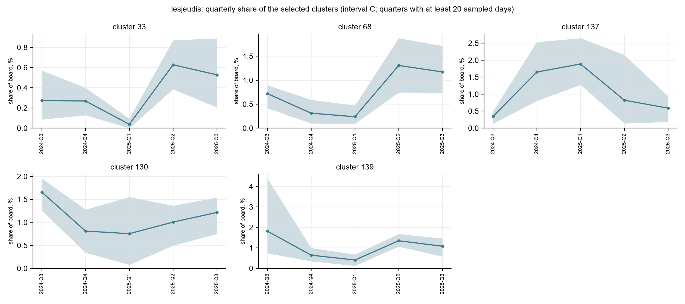

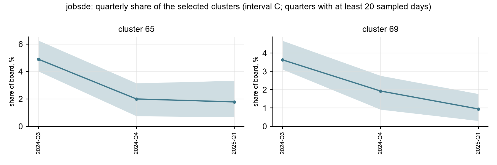

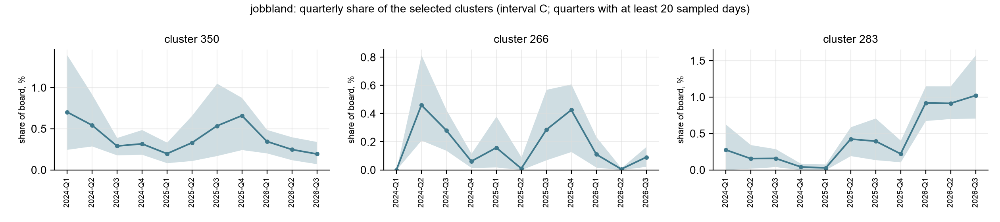
- Lesjeudis: none of the five clusters rises over the period. Clusters 33, 68 and 139 dip in 2025-Q1 and recover in 2025-Q2 (cluster 33 from about 0.04% to 0.63%), 137 peaks in 2024-Q4 to 2025-Q1 (about 1.9%) and falls, 130 falls from the first quarter and recovers slightly. The bands overlap across quarters for most of the series, so the movements are within the sampling uncertainty.
- Jobs.de: clusters 65 and 69 fall from 2024-Q3 to 2025-Q1 (65 from about 4.9% to 1.8%, 69 from 3.6% to 0.9%). Only three quarters are usable.
- Jobbland: cluster 350 and 266 move within a small share (below 1%). Cluster 283 is flat below 0.5% until 2025-Q4, then rises to about 0.9% in 2026-Q1 and 1.0% in 2026-Q3, with a band clearly above the earlier quarters. This is the rise explained by the change in the title wording (place-words table above).

**Occupation Emergence Rate per quarter** (`lesjeudis_oer.png`, `jobsde_oer.png`, `jobbland_oer.png`). Number of clusters newly crossing the threshold and the number that are clearly new under the stricter rule, for the whole board (all eligible clusters, not only the selected ones). The first usable quarter is zero by construction.

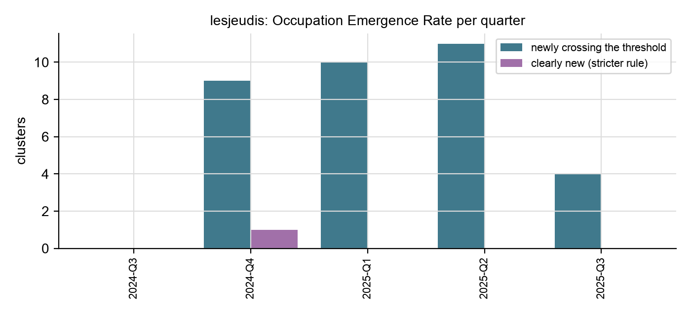

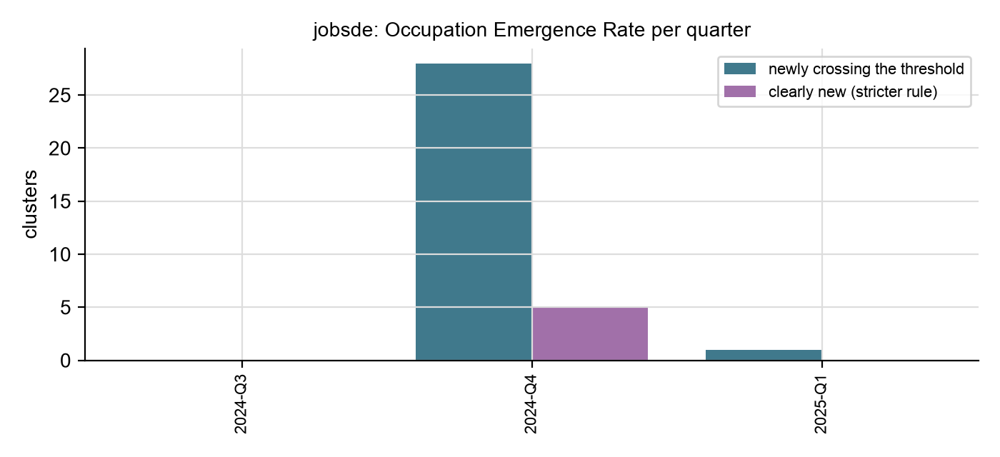

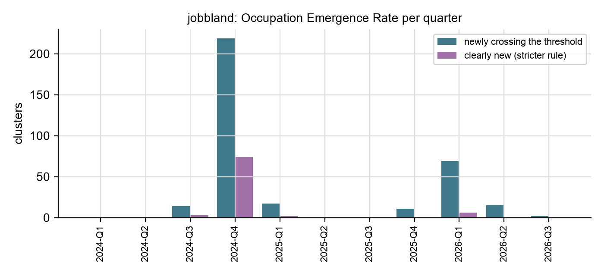
- Lesjeudis: 9, 10, 11 and 4 clusters newly cross in 2024-Q4 to 2025-Q3; one is clearly new (2024-Q4).
- Jobs.de: 28 cross in 2024-Q4 and 5 of them are clearly new; 1 crosses in 2025-Q1.
- Jobbland: about 219 cross in 2024-Q4 and 74 are clearly new, which is the coverage jump (more postings, and clusters that were below the sampling floor before). A second spike of about 69 (6 clearly new) in 2026-Q1 coincides with the board-wide change in the title wording. These spikes are artefacts of the data and not waves of new occupations; the validated count remains zero.

**Regional concentration of the selected clusters** (`lesjeudis_hhi.png`, `jobsde_hhi.png`, `jobbland_hhi.png`). Normalised HHI over NUTS-2 regions for the whole period, with the unplaced share and the number of placed postings above each bar.

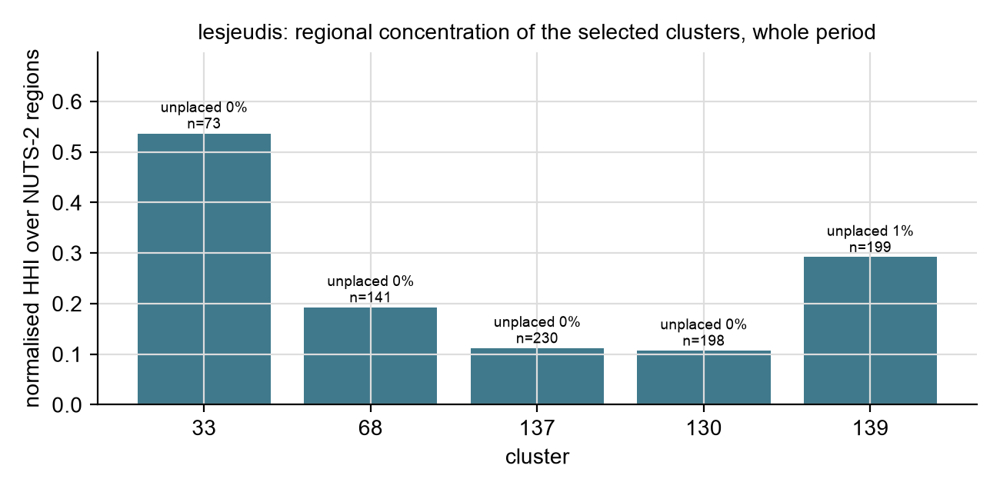

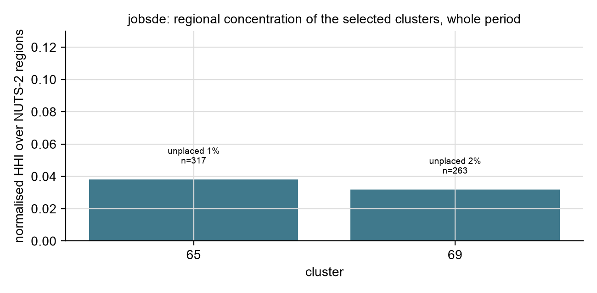

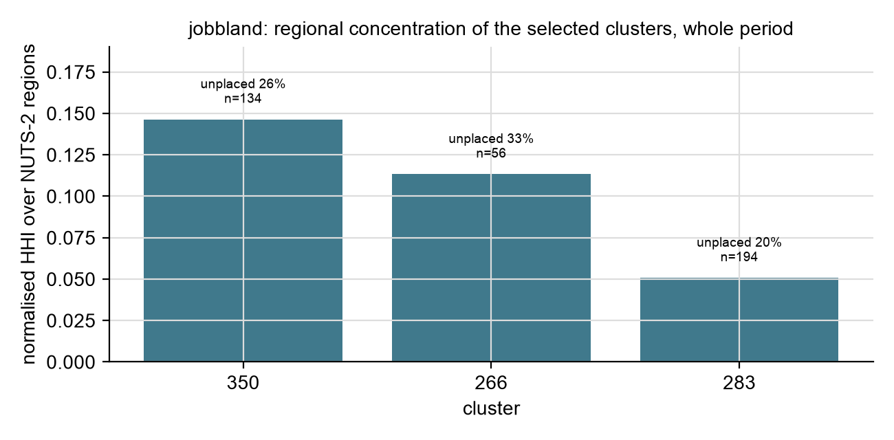
- Lesjeudis: cluster 33 is the most concentrated (about 0.54), then 139 (about 0.29), 68 (about 0.19), 137 and 130 (about 0.11). Île-de-France is 45.7% of the board, so some concentration is expected; only 33 is clearly above it (regional table above).
- Jobs.de: both clusters are near 0.03-0.04, i.e. spread over many regions.
- Jobbland: 350 about 0.15, 266 about 0.11, 283 about 0.05. The unplaced shares (20-33%) are high because the figure uses the whole period, including the quarters in which the location text had collapsed (per-quarter HHI section); the regional table above uses the two valid windows and should be preferred.

### UMAP map with the named occupations (script 112, 15 November)

Files: `docs/../docs/fig/umap_lesjeudis.png`, `umap_jobsde.png`, `umap_jobbland.png`. Each map is a two-dimensional UMAP (cosine, 30 neighbours) of all title embeddings of the board (input A). Grey = all postings (a sample is drawn), colour = the selected clusters, open markers = postings whose cleaned title matches one of the seven named occupations (same regexes as script 92; never forced). The map is for illustration and validation. The clusters come from the ten-dimensional UMAP, and distances in two dimensions are only approximate.

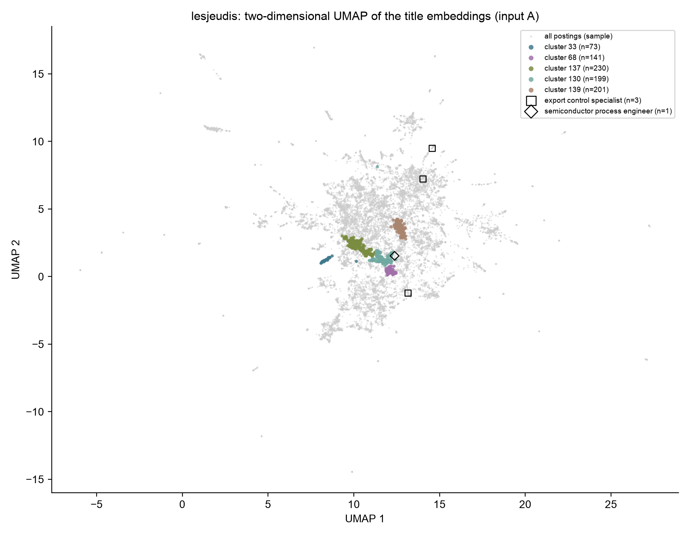

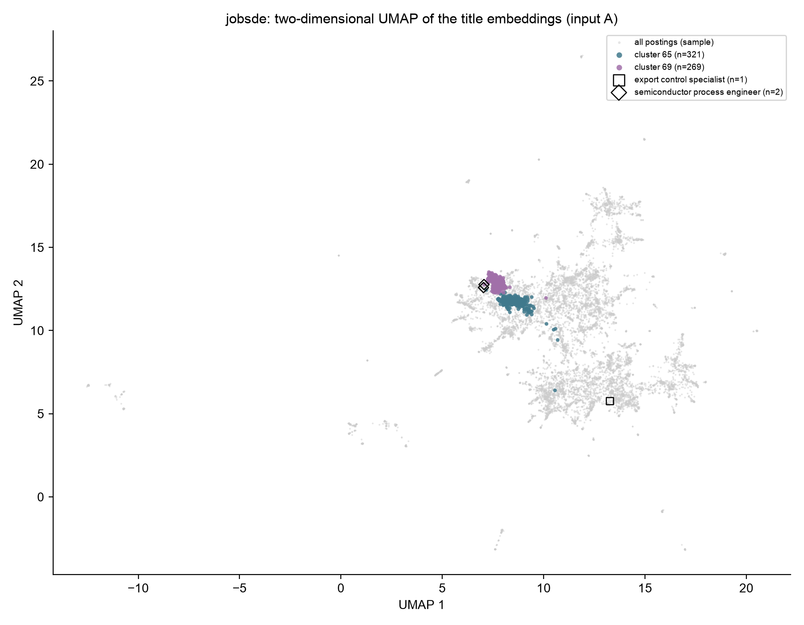

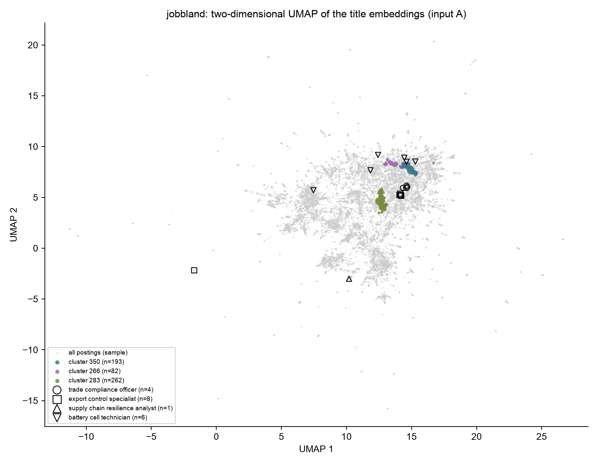

Named occupations found by title:

| named occupation | jobbland | jobs.de | lesjeudis |
|---|---|---|---|
| trade compliance officer | 4 | 0 | 0 |
| export control specialist | 8 | 1 | 3 |
| supply chain resilience analyst | 1 | 0 | 0 |
| semiconductor process engineer | 0 | 2 | 1 |
| battery cell technician | 6 | 0 | 0 |
| critical materials specialist | 0 | 0 | 0 |
| reshoring program manager | 0 | 0 | 0 |

Reading:
- The seven named occupations are almost absent: 19 matching titles on jobbland (53,959 postings), 3 on jobs.de (12,243) and 4 on lesjeudis (18,625). Critical materials specialist and reshoring program manager are not found on any board, and semiconductor process engineer is not found on jobbland.
- Selected clusters are compact groups on the map and separate from each other. Lesjeudis cluster 33 is a thin strand, which fits the one-employer template found in the employer check. Jobbland clusters 283 and 350 lie in different places, with 283 below and 350 above the group of trade-compliance and export-control titles.
- On jobbland the trade-compliance (4) and export-control (7 of 8) titles form one tight group between clusters 283 and 350. The battery-cell titles (6) are scattered over five places and do not form a group. The one supply-chain-resilience title and one export-control title lie far from the others (the export-control title at the lower left, the supply-chain title below the main mass). On jobs.de and lesjeudis the few matches are scattered; the two jobs.de semiconductor titles lie right next to cluster 69, which is an ordinary occupation, so the map does not show them as a group of their own.
- Where the matching titles sit (cluster assignment, script 112, second version; the first version counted noise as a cluster and is not used):

| board | named occupation | matches | in noise | other placements |
|---|---|---|---|---|
| jobbland | trade compliance officer | 4 | 3 | 1 in cluster 263 |
| jobbland | export control specialist | 8 | 7 | 1 in cluster 20 |
| jobbland | supply chain resilience analyst | 1 | 0 | cluster 71 |
| jobbland | battery cell technician | 6 | 4 | 1 in cluster 321, 1 in another cluster |
| jobs.de | export control specialist | 1 | 0 | cluster 52 |
| jobs.de | semiconductor process engineer | 2 | 0 | 1 in cluster 69, 1 in another cluster |
| lesjeudis | export control specialist | 3 | 1 | 1 in cluster 108, 1 in another cluster |
| lesjeudis | semiconductor process engineer | 1 | 0 | cluster 86 |

- The tight group on the jobbland map (trade compliance and export control titles between clusters 283 and 350) is noise: 3 of 4 and 7 of 8 of those titles belong to no cluster, so HDBSCAN did not find it as a cluster. With 10 or fewer postings it is far below the minimum cluster size of 40. The same holds for the battery-cell titles (4 of 6 in noise).
- No named occupation has more than one title in any cluster. They are therefore not found as clusters on any board, and no named occupation is validated or forced. This agrees with the finding that no cluster is validated as an emerging occupation: the occupations named in the brief exist in the titles but only as a handful of postings, below the size at which the method can see them.
- Consequence for the method: a named occupation with fewer than about 40 postings cannot be detected by the clustering. It can only be tracked through the seeded variant (script 106) (seeded section above).

### Check of the named-occupation terms against the Skillab API (script 113, 15 November)

The two named occupations that no board shows in the titles (critical materials specialist, reshoring program manager) were also searched in the Skillab API itself, which holds all postings of the three sources and not only our sample of days. One query per source and keyword, up to 5 pages of 100 postings. "Postings" = postings returned by the API's keyword search; "title" = postings with a keyword word of more than three letters in the title (a weak test: any one word counts).

| keyword | jobbland.se | lesjeudis.com | jobs.de |
|---|---|---|---|
| critical raw materials | 83 (3 in title) | 5 (1 in title) | 0 |
| critical materials | 500, page limit reached (11 in title) | 116 (2 in title) | 5 (0 in title) |
| rare earth | 69 (1 in title) | 5 (0 in title) | 0 |
| reshoring | 0 | 0 | 0 |
| nearshoring | 6 (0 in title) | 0 | 0 |
| onshoring | 0 | 0 | 0 |
| matières premières critiques | 0 | 0 | 0 |
| kritische Rohstoffe | 0 | 0 | 0 |
| kritiska råvaror | 0 | 0 | 0 |

Reading:
- Reshoring, nearshoring in a title and onshoring do not occur as titles in any of the three sources. Reshoring and onshoring are not found at all in the postings, and nearshoring appears in 6 jobbland postings (a business-development representative, a business analyst and payroll specialists), none with the word in the title.
- The critical-materials terms return postings, but the titles are unrelated occupations (a PhD student in mining waste, a warehouse production planner, a mechanical design engineer, a finance consultant). The terms appear in the descriptions only. The search appears to match words anywhere in the text: "critical materials" returns more postings than "critical raw materials", which would not happen with an exact phrase. This is inferred and not checked in the API documentation.
- The non-English phrases return nothing on all three sources. Many titles of the Swedish board appear in English in the API (for example "PhD student in Mining Waste Facility and Life Cycle Assessment") next to Swedish ones, so a zero for a Swedish, German or French phrase does not prove that the term is absent. The language handling of the API is a question for the Skillab team (item 11).
- Result: the check agrees with the title matches in the clusters. The two named occupations are not found as job titles on these boards.

## Update of 13 November: results, candidates and conclusion

**Where Month 4 stands.** No validated emerging occupation cluster has been found on the three boards. The 6 to 10 clusters chosen by size and flagged share, the selection step (c) in the plan sent to the supervisor, can still be delivered with their series, HHI and a verdict on emergence; none of them shows validated emergence. Two lesjeudis candidates (clusters 68 and 139) were tested against employer mix and coverage and do not hold. What the data do support is a defence-flagged engineering and cybersecurity core on lesjeudis that nvertheless results from postings of three or four employers, a flagged footprint that moves between employers over time, and the seven named occupations as counts below ten postings each. The numbers under "Results so far" and in the first cluster series below come from the first clustering, before title cleaning and title inference, and are superseded by this section. **Added on 14 November:** with a stricter rule for "clearly new" (wholly below the threshold in every earlier quarter, not only the previous one) the five lesjeudis "clearly new" clusters become one (DevOps, French titles), and that one is a posting campaign of one employer (Sopra Steria). Clusters 68 and 139, and the Java and systems administrator clusters, were at or near the threshold in 2024-Q3, dropped in 2025-Q1 with the posting cycles of individual employers (Capgemini, CGI, Thales) and returned in 2025-Q2. We find no new occupation cluster on lesjeudis (input A). **Added on 15 November:** the same rule on jobs.de and jobbland (input A) gives the same answer: the "clearly new" clusters are ordinary occupations or board and coverage effects, none is flagged above 3% (jobs.de) or is an emerging flagged cluster (jobbland); see the section "Update of 14 November".

**Titles.** Title cleaning (script 90) has a second stage: lead-in sentences, contract, hours and date fillers, references and addresses, trailing places and, on boards where capitalised words are under 55% of title words, an employer tail ("for", "to", "at", "till", "för", "hos", "chez" followed by a proper name). The first stage had left place and employer words in many titles, and the first clusters formed around them. The 1,389 title-less jobbland postings (December 2025 to January 2026) got an inferred title from the description with Qwen 2.5 7B (script 99). On a manual check (i.e. human classifier on a sample), 88% of inferred titles named the same occupation as the real one (Wilson 95% interval 80% to 93%). 1,385 postings got a title and 4 stay without one (UNKNOWN). Clusters 171 and 168 of the first run no longer exist.

**Reclustering.** Input A was rerun on the cleaned and inferred titles: jobbland.se 357 clusters (34.3% noise), lesjeudis.com 144 (30.9%), jobs.de 71 (27.6%). Input D gave 358, 139 and 80 clusters (35.2%, 28.9% and 29.5% noise) but is not used for selection, because D v1 is withdrawn.

**Named occupations, checked directly on jobbland (script 101).** The regexes were corrected after the first check produced false matches: solar-cell sellers matched "battery cell technician" (11 of 17 hits), "individual users" matched "dual use", and "Raw Material Manager" matched critical materials. After the correction, jobbland holds 5 trade compliance titles, 7 genuine export control titles (a further hit is a customs course code), 6 battery cell titles, 1 supply chain resilience hit (a doctoral student post, not an occupation) and none for semiconductor process engineer, critical materials specialist and reshoring program manager. A cluster needs 40 postings, so none of these can form one; they are reported as counts by quarter. The earlier check of lesjeudis and jobs.de found 0 to 1 per occupation and was not rerun after the pattern fix.

**Named occupations, second route: seed skills (script 108).** To test whether the seven occupations are better found through skills than through titles, we took, for each occupation, the ESCO skills that describe it (found in `lexicon/skills.csv`) and the matching Lightcast terms, and counted the postings that carry any of them. Four occupations have specific ESCO skills: trade compliance (customs compliance, customs law, import-export regulations and licences), export control (export control principles, export regulations of dual-use goods, embargo regulations), semiconductor process (wafer cleaning and polishing, photolithography, semiconductor testing) and battery cell (battery formation and conditioning, battery chemistry, battery components, battery test equipment). Supply chain resilience has only generic supply chain skills, critical materials only "materials engineering (battery material)" and "implement mineral processes", and reshoring program manager has no ESCO skill. The idea follows the seed-skill indicator of Dawson, Williams and Rizoiu (2021), who start from a few seed skills and follow the skills that co-occur with them.

The seeds are listed in the next table. The Month 3 lexicon column holds the terms of the Month 3 lexicon that correspond to each occupation. The ESCO column holds the skills used in script 108 (`lexicon/skills.csv`), and the Lightcast column the terms of the pruned Lightcast block (`lexicon/lightcast_block_terms.csv`, 135 selected terms; script 91). I searched all 629 terms of that file for export, customs, trade, sanction, dual, tariff, licence, compliance, import, rare, lithium and reshoring: the only match is Certified Customs Specialist.

| Named occupation | Month 3 lexicon terms | ESCO skills used as seeds (script 108) | Lightcast terms in the block | Assessment |
| --- | --- | --- | --- | --- |
| Trade compliance officer | trade compliance, export controls, dual-use goods, sanctions compliance, customs compliance, rules of origin | ensure cargo complies with customs regulations; ensure customs compliance; customs law; keep up to date with customs regulations; advise on customs regulations; international import export regulations; manage import export licenses; import-export commercial documentation | Certified Customs Specialist | Strong, but the skills describe customs clearance and freight forwarding as much as trade compliance |
| Export control specialist | export controls, export licensing, dual-use goods | export control principles; export regulations of dual-use goods; comply with export regulations in different countries; advise clients on export restrictions; embargo regulations | none in the block | Strong and very specific |
| Semiconductor process engineer | semiconductor sovereignty (a policy term) | clean wafers; polish wafers; load electronic circuits onto wafers; imprint circuit design onto wafers (photolithography); slice crystals into wafers; produce semiconductor crystals; test semiconductors; inspect semiconductor components | Semiconductor Manufacturing Process; Wafer Fabrication; Wafer Testing; Wafer Bonding; Wafer Dicing; Semiconductor Device Fabrication; Semiconductor Fabrication Plant; Semiconductor Package; Lithography; Photolithography; Dry Etching; Plasma Etching; Thin Film Coating; Metallization | Strong for process roles |
| Battery cell technician | battery materials (ambiguous) | battery formation, conditioning and cell preparation; battery chemistry; battery components; assemble batteries; operate battery test equipment; repair battery components; battery management systems; battery testers | Battery Production Process; Battery Formation; Battery Production Equipment; Battery Recycling Processes; Battery Industry; Battery Inspection; Battery Life Cycle Management; Battery Maintenance; Battery Disassembly; Battery Cycler; Battery Diagnostics; Battery Charge/Discharge; Battery Conditioning (also in the block: Assemble Batteries, Cell Assembly Process, Formation Cycles) | Strong. "Change watch battery" and "install automotive batteries" are left out |
| Supply chain resilience analyst | supply chain resilience, supply chain security, supply chain diversification, dual sourcing | analyse supply chain strategies; analyse supply chain trends; detect bottlenecks in the supply chain; supply chain principles; supply chain management | none specific: the block holds 70 generic supply chain terms (for example Demand Planning, Reverse Logistics, Material Requirements Planning). The plain term "Supply Chain" is boilerplate on lesjeudis (351 of 352 postings in one cluster) and is not used | Too broad as a seed: it picks up every supply chain role |
| Critical materials specialist | critical raw materials, CRMA, battery materials | implement mineral processes; materials engineering (battery material) | 11 material terms: Beryllium; Carbon Graphite; Germanium; Gallium Nitride; Indium Antimonide; Indium Gallium Arsenide; Mercury Cadmium Telluride; Silicon Carbide; Epitaxy; Helium Extraction; Helium Liquefaction (not used as seeds in script 108; they mostly mark semiconductor and optics materials) | Weak: no critical-raw-materials skill in ESCO |
| Reshoring program manager | reshoring, nearshoring, friend-shoring, onshoring, China plus one | none | none | No ESCO or Lightcast seed; only the lexicon terms could serve |

| Occupation | By title regex (jobbland / lesjeudis / jobs.de) | By seed skills or Lightcast terms | Of these, titles that hold the occupation (reading of titles) |
| --- | --- | --- | --- |
| Trade compliance officer | 5 / 0 / 0 | 41 / 4 / 10 | about 18 / 0 / 5 |
| Export control specialist | 8 / 3 / 1 | 5 / 4 / 0 | 0 / 0 / 0 |
| Semiconductor process engineer | 0 / 1 / 2 | 18 / 2 / 7 | 0 / 0 / 4 (optoelectronics and semiconductor development) |
| Battery cell technician | 6 / 0 / 0 | 51 / 1 / 2 | about 8 / 0 / 1 |
| Supply chain resilience analyst | 1 / 0 / 0 | 456 / 517 / 21 (generic skills) | not meaningful |
| Critical materials specialist | 0 / 0 / 0 | 82 / 14 / 13 | seed unusable |
| Reshoring program manager | 0 / 0 / 0 | no seed | none |

Skills find more postings than titles do, but most are false matches or topic mentions, not the occupation. Reading the titles of the carriers, only trade compliance has a group of real role-holders (about 18 on jobbland and 5 on jobs.de), and these are mostly customs clearance and freight forwarding, an established occupation; three jobbland titles are trade-governance roles (Global Trade Program and Systems Governance Manager, Trade Compliance Officer, Export Control Manager), all dated September 2025 or later, which is too few to read as a trend. The export control skills produced no title of an export control role. The semiconductor carriers on jobbland include none that is a process role and half share the skill "monitor satellites", which suggests a space or optics employer's template; on jobs.de four of seven are in optoelectronics or semiconductor development. Battery carriers include about eight engineering or production roles on jobbland, seven research posts and several salespeople and electricians. The seeds for supply chain and critical materials give false matches (for example "implement mineral processes" on IT and finance roles) and are not used. A seed marks a topic, not a role, and the extraction has false matches, so these counts are upper bounds. The skill-seeded variant is not pursued as a series; the counts are reported as a second check on the named occupations, which agrees with the title search: the occupations are present only in handfuls.

**Emergence by board.**

- **jobbland.se.** Weighted postings per quarter swing from 727 to 166,360, so quarterly crossings follow coverage. For example, assuming a cluster that is always 0.1% of the board’s postings:
    - In a quarter that has 727 weighted postings, its postings are 0.1% × 727 = 0.7 postings. That is below the threshold of 100.
    - In a quarter with 166,360 weighted postings, it counts are 0.1% × 166,360 = 166 postings. That is above 100, so it “crosses”.

The monthly run from 2026-02-01 to 2026-08-31 around AccelerateEU (22 April 2026) lists "clearly new" clusters that are cleaners, preschool staff, concrete workers and doctors, none flagged (under the stricter rule of 15 November only the cleaners and the preschool staff remain; concrete workers and doctors are returns after a dip). Samples of the flagged clusters with a rise (291 quality engineer, 263, 232 production technician, 350 systems engineer) show consultancy staffing patterns that exist from 2024, or 6 postings in total (263). No candidate.
- **jobs.de.** Three usable quarters. The 28 "new" crossings in 2024-Q4 are the board starting up, and the rise of the electronics cluster from 1.01% to 11.75% compares a partial first quarter with a thin last one. No emergence evidence; the board is used for validation only. *Update of 15 November:* under the stricter rule, 5 clusters are clearly new in 2024-Q4 (accountants, HR clerks, branch managers, warehouse staff, sales assistants), all flagged at 0% to 3%; see the update section.
- **lesjeudis.com.** Clusters 68 (embedded software, aeronautics and defence) and 139 (cybersecurity) are "clearly new" [^2] in 2025-Q2 (monthly: 2025-05), with 57% and 38% of postings flagged at medium intensity or higher and event changes of +0.63% (+0.20 to +1.21) and +0.96% (+0.42 to +1.79) around InvestAI. The monthly series shows both already above the line in 2024-08, and cluster 139 peaks in 2024-08 (2.29%). Flagged postings per quarter (2024-Q3 to 2025-Q3) are 22, 5, 2, 15, 15 for cluster 68 and 13, 5, 1, 12, 8 for cluster 139. The "new" status comes from comparing with 2025-02 (16 sampled days), the last usable month before a coverage gap (2025-03, 2025-04 and 2025-07 are unusable). In reality, the clusters had been above the threshold before; they didn’t appear for the first time. The largest clear rises (Product Owner 0.59% to 4.52%, data analysts) are not flagged and reflect IT and data roles gaining share on the board. *Update of 14 November:* on the quarterly series, the Java and systems administrator clusters were clearly above the threshold in 2024-Q3, and the interval of clusters 139 and 68 reaches the line there; all four are below it in 2025-Q1 and above it again in 2025-Q2. The stricter rule no longer counts them as new (see below).

[^2]: A cluster is “clearly new” in a month if its whole interval is above the threshold now, and its whole interval was below the threshold in the previous usable month.

**Flag intensity.** The flagged share counted every tag, including `low`, which the annotation guide gives to a role whose duties are outside the sector and where the sector appears only in the company text. However, since we are examining emerging occupations with respect to their role and duties in the context of deglobalization, they should be disregarded. For this reason Script 93 was adjusted to only filter `--min-intensity medium` and `high`. Cluster 117 (head of IT project) falls from 34% to 11% flagged and drops out; clusters 68 (60% to 57%) and 139 (43% to 28%) hold. Script 98 now prints the intensity of each flagged posting.

**Employer concentration (script 103).** The employer field is empty on lesjeudis, so we used a script to take the employer namen from known names in the first 1,500 characters of the description (Thales, Sopra Steria and CS, Safran, Alten and about 35 more; 1 to 19 of 19 to 78 postings per cluster are unmatched). Flagged postings at medium intensity or higher:

| Cluster | Title | Flagged postings | Effective employers | Largest employer share |
| --- | --- | --- | --- | --- |
| 99 | Program manager | 27 | 1.1 | Thales 96% |
| 33 | IVVQ engineer | 67 | 1.2 | Thales 92% |
| 61 | Software architect | 28 | 1.3 | Thales 88% |
| 107 | Engineering manager | 43 | 1.3 | Thales 86% |
| 127 | Systems engineer | 34 | 1.8 | Thales 72% |
| 56 | Software architect, defence and security | 27 | 2.3 | Sopra Steria 58% |
| 133 | AI engineer | 19 | 2.3 | Thales 62% |
| 67 | Software validation engineer | 36 | 2.6 | Thales 54% |
| 130 | Electronics engineer | 102 | 2.8 | Thales 56% |
| 68 | Embedded software engineer | 78 | 3.3 | Thales 42% |
| 139 | Cybersecurity engineer | 48 | 3.9 | Thales 41% |

To discuss the findings on employers, we will use the concept of ``Effective employers''. This is a standard transformation of the Herfindahl–Hirschman Index and is equal to 1 divided by the sum of squared employer shares. For example, if one employer holds 96% of a cluster’s postings and the rest is spread thinly, Σs² is ~0.92, so the effective number is about 1/0.92=1.09. That can be interpreted as “the cluster behaves as if it had one employer”.. Over the whole board, Thales rises from 3.5% of all postings taken in 2025-Q1 to 7.0% in 2025-Q2 and 9.0% in 2025-Q3, and its flagged postings from 95 to 198 and 257, while Sopra Steria and CS flagged postings fall from 129 (2024-Q3) to 33 (2025-Q3):

| Quarter | Thales share of postings taken | Thales flagged postings | Share of all flagged postings |
| --- | --- | --- | --- |
| 2024-Q3 | 4.7% | 134 | 30% |
| 2024-Q4 | 4.0% | 201 | 44% |
| 2025-Q1 | 3.5% | 95 | 34% |
| 2025-Q2 | 7.0% | 198 | 49% |
| 2025-Q3 | 9.0% | 257 | 56% |

The clusters that first cross the line in 2025-05 to 2025-08 (33, 67, 99, 107) are the Thales-dominated ones. Counts are postings taken, not weighted, so shares are compared and not counts. The data cannot say whether Thales posted more or the board covered it better from 2025-Q2.

**Conclusion.** Under the criteria used (clearly new or a clear rise in share, at least 25% flagged at medium intensity or higher, coherent content, not an employer pattern), no cluster is validated as an emerging occupation. Reported instead: (1) the named occupations as counts; (2) a lesjeudis defence-flagged core that is concentrated in a few employers, with five clusters that are employer patterns (33, 61, 99, 107, 127) and the rest of the core (56, 67, 68, 130, 133, 139) too concentrated or too flat to call emerging; (3) declines of defence-flagged IT and systems clusters after InvestAI (137, 126, 136, 116), read with the coverage gap; (4) the negative results for jobbland.se and jobs.de; (5) the intensity filter and the employer check as methods. The thesis calls the flagged clusters "concentrated in a few employers" and does not call them emerging. *Update of 14 November:* the stricter rule and the employer cycles (see the update section) leave the conclusion unchanged for lesjeudis and also remove the DevOps cluster, the only one that passed the stricter rule.

**Options for Month 5, to agree with the supervisor.** Cluster only the flagged postings with a smaller minimum cluster size (about 20), which can separate small occupations but depends on the tagger by construction. A series that caps any single employer's share. Ask Skillab, through the supervisor, whether sources or employer coverage changed in 2025.

**Supervisor guidance not yet applied.** From the earlier exchange on weights, clustering and HHI:

- **Weights.** Normalise the weights to \[0, 1\], possibly with a logarithm, so that very large weights (for example 200 on a high-volume day) do not dominate. The inverse-probability weight is the unbiased estimator of the population share, so it stays the main estimate. Script 93 now has `--weight-mode log` and `--weight-mode cap` to rerun the shares and intervals as a sensitivity check; the verdicts on the candidate clusters are then compared across the three modes.
- **Number of clusters.** The supervisor found 256, 141 and 79 clusters too many and asked for 3 to 4 clustering algorithms compared by silhouette score. The current runs give 357, 144 and 71 clusters on input A. The algorithm comparison by silhouette was made on 15 November (see the update below): HDBSCAN has the highest silhouette in the UMAP space, the silhouette does not favour fewer or more clusters, so the count stays a consequence of the minimum cluster size. The silhouette is computed on the non-noise points of each method, and HDBSCAN noise has to be reported next to it.
- **Preserving specific clusters.** The supervisor suggested intervening in the clustering to keep chosen clusters, based on the distances between them. A seeded variant (titles of the seven named occupations and of the flagged clusters as fixed centres, postings assigned within a cosine distance) would also catch occupations with fewer than 40 postings, which HDBSCAN cannot form.
- **Lightcast weight.** The Lightcast block should have the same weight as the ESCO block; D v1 used 0.5 and 0.3. D is withdrawn and is not used for selection, and D v2 should use equal weights.
- **HHI and the thesis question.** The supervisor reads the index as a measure of how far specific domains dominate a market, and the aim as quantifying how far larger markets are more or less similar to smaller ones in the composition and concentration of their skill sets. The employer concentration reported above fits this reading; what "larger and smaller markets" refers to (boards, countries or clusters) is to be confirmed.

## Supervisor answers of 14 November, and what each decision means

The supervisor answered the four questions of the email. Option A is adopted: the 6 to 10 clusters are described as concentrated, flagged occupation clusters, and emergence is reported as a finding for each cluster. The notes below explain each decision in plain words, with the example used in the discussion.

**1. Option A or Option B (how the 6 to 10 clusters are chosen).** Option A selects clusters by size and flagged share (step (c) of the plan the supervisor approved) and then reports for each one whether it is emerging. Option B makes emergence the selection rule, so only clusters that pass the emergence test are delivered. Example: lesjeudis cluster 33 (embedded software, Thales at about 42% of its postings) is large and strongly flagged, so it is selected under A, with the finding "present since 2024-08, concentrated in 3 to 4 employers, not emerging". Under B it is dropped, and since no cluster passes both the emergence test and the flag test, B delivers zero clusters. The only cluster with a clear rise on lesjeudis is cluster 3 (Product Owner), which is not flagged, so under B it would be the only cluster "in", although it has nothing to do with deglobalization. A keeps the deliverable and keeps the negative result visible.

**2. Inverse-probability weights as the main estimate.** The collection takes about 100 postings from one page per calendar day, so a posting stands for (day total / postings taken that day) postings. Example: a day with 1,000 postings of which 100 are taken gives each posting weight 10; a day with 200 postings of which 100 are taken gives weight 2. Without weights the quiet day counts as much as the busy day. The weights are the only way the sample is unbiased for the whole board, so they stay the main estimate. They also make the quarterly totals swing (jobbland 727 to 166,360 weighted postings), because a few days carry very large weights. Two sensitivity runs test this: log-scaled weights (log(1+w), so a weight of 1,000 counts about 3 times a weight of 10, not 100 times) and capped weights (cut at the 95th percentile). They trade some bias for lower variance. If a verdict (new, rising, flat) is the same under all three, it does not depend on the weighting; the counts and the 100-postings threshold lose their meaning under log and cap, so only shares and verdicts are compared. The supervisor agreed to re-run and decide from the results.

**3. Silhouette comparison and the seeded variant.** The silhouette of a posting is (distance to the nearest other cluster minus distance to its own cluster) divided by the larger of the two, from -1 to 1. Example: a posting 0.2 from its own cluster centre and 0.6 from the nearest other cluster scores (0.6 - 0.2) / 0.6 = 0.67 (well placed); a posting at 0.4 and 0.45 scores 0.11 (on the boundary). The mean silhouette over the postings of a clustering allows 3 to 4 algorithms (for example HDBSCAN, k-means, agglomerative, HDBSCAN on UMAP) to be compared on the same input, reporting the share of noise next to it, since an algorithm that drops a third of the postings as noise can score high on the rest. The cluster counts (357, 144 and 71) are only a result of one setting and should be fixed by this comparison before the remaining analysis is built on it. The supervisor also notes that titles alone are unlikely to give clusters of emerging occupations, because employers use a general title and put the detail in the description; input D (titles with ESCO and Lightcast skills) addresses this and is compared in the same way. The seeded (constrained) variant is a complementary method: it fixes centres from postings of chosen occupations (for example the titles that contain "export control"), lets a posting join a centre when its cosine distance is under a threshold, and clusters the rest freely. A named occupation then cannot dissolve into a larger cluster, and the question becomes whether the seed grows over time.

**4. "Larger and smaller markets".** The supervisor confirms that markets are the boards or countries: Sweden (jobbland, 53,959 postings), France (lesjeudis, 18,625) and Germany (jobs.de, 12,243). The question is whether the larger board is more or less similar to the smaller ones in the composition (which skills and sectors make up the postings) and the concentration (how much a few of them dominate) of its skill sets. HHI falls as a sample grows, so a large board looks less concentrated for no real reason; the comparison therefore uses equal-size subsamples next to the whole-board value. Composition is compared with a similarity score (Jensen-Shannon, 1 = identical) on the skill and sector labels the boards share. The boards are never merged. This is built in script 104 (docs/boards\_concentration.md): HHI and top-10 share over skills, sectors, clusters, NUTS-2 regions and employers per board, and the same by quarter. The organisation field is empty on all three boards, so employer concentration cannot be computed across whole boards; it is reported only for the clusters checked with script 103.

**Result for question 2 (lesjeudis, monthly, flag intensity medium or higher, log and capped weights; weights rescaled to the same board total).** No verdict changes in a way that matters. The clusters with the largest flagged share are the same under both transformations and under the default weights, and their flagged shares move by at most 2 points (cluster 33: 93% and 94%; 68: 57% and 57%; 137: 49% and 48%; 130: 49% and 48%; 139: 28% and 29%). The clear rise of cluster 3 (Product Owner, unflagged) is the same: 0.82% to 3.65% under log weights, 0.83% to 4.12% under capped weights, clear in both. The “clearly new” lists overlap in five of seven clusters (1, 12, 68, 75, 137). The two that differ are borderline: 139 is clearly new under capped weights only, and 125 (log) and 65 (capped) appear in one transformation only. The count of clearly new clusters per month is the same under both transformations in 2024-11 and 2025-05 (2 and 3). Clusters 68 and 139 are clearly new in 2025-05 under both weightings, but they already crossed the threshold in 2024-08, so this is the effect of the missing March and April 2025 data, not weighting; weighting does not resolve that. The inverse-probability weights stay the main estimate. *Update of 14 November:* the "clearly new" lists in this paragraph use the original rule (previous period only); under the stricter rule, which does not depend on the weights, most of them drop out (see below).

**Result for question 4 (script 104, common window 2024-08-01 to 2025-04-09).** The largest board (Sweden) is not the most different from the smaller ones, and concentration does not fall or rise steadily with board size. Skills are the ESCOX skills extracted from the full text (script 69b), the same method for every board and month; the tracker (API) tags are not used, because they are missing on jobbland from mid-2025.

| Board | Skills: effective number (HHI) | Sectors: effective number (HHI) | Regions: normalised HHI |
| --- | --- | --- | --- |
| Sweden (jobbland, largest) | 200 (0.0050) | 62 (0.0162) | 0.052 |
| France (lesjeudis) | 311 (0.0032) | 45 (0.0222) | 0.199 |
| Germany (jobs.de, smallest) | 296 (0.0034) | 91 (0.0110) | 0.019 |

Similarity of composition (Jensen-Shannon, 1 = identical):

| Pair | Skills | Sectors |
| --- | --- | --- |
| Sweden and Germany | 0.79 | 0.89 |
| Sweden and France | 0.71 | 0.85 |
| France and Germany | 0.64 | 0.80 |

Sweden is the most concentrated in skills, France in sectors and regions (Île-de-France), and Germany the most diffuse in sectors and regions. The largest board is the most similar to both others, and the two smaller boards are the least similar to each other. With three boards, size cannot be separated from country, language and platform, so these are descriptions of the boards, not an estimate of an effect of size. The values are stable across quarters within each board (Sweden skills HHI 0.0044 to 0.0057 over eleven quarters), so the differences between boards are structural, not caused by one period. Equal-size subsamples give the same values as the whole boards, so sample size is not behind the differences. Limits: the sector labels come from the tracker and are filled for about 90% of jobbland postings only up to 2025-05, which is why the comparison uses the common window; the cluster HHI is not compared across boards, because the same minimum cluster size gives 357, 144 and 71 clusters; jobs.de 2025-Q2 rests on 349 postings.

**Order of work.** (1) The log and capped weight runs and the board comparison (script 104). (2) The silhouette comparison of the algorithms for inputs A and D v2, and the seeded variant, on Colab. (3) Fix the final clustering setup, then rebuild the series, HHI and the verdict per cluster.

**Status of the order of work on 14 November.** (1) is done. (2) is done for lesjeudis: D v2 and D v3 were compared with A on title coherence and on emergence (below); the algorithm comparison (six board and input combinations) and the seeded variant (jobbland) are reported in the update below. (3) Proposed, to be confirmed with the supervisor: input A is the main input, D v3 and D v2 are documented sensitivity checks. The series, HHI and verdicts are rebuilt on A with the stricter rule for lesjeudis, jobs.de and jobbland (15 November).

## Update of 14 November: inputs, a stricter rule for "clearly new" and employer waves

All numbers in this section are for lesjeudis (18,625 postings, France), except where the three boards are named. Flagged shares in the tables of the emergence reports are at the default intensity (every tag), not at medium or higher, so they are higher than the shares quoted above (for example cluster 139: 43% here, 28% at medium or higher).

### Input D v2 and D v3 against A: title coherence (script 107)

Coherence of a cluster is the length of the mean of the unit title embeddings of its postings after centring on the board mean (1 = identical titles, 0 = unrelated). The lift is the coherence minus that of random sets of the same size. A cluster is weak when its lift is below the 10th percentile of the lift of A's clusters (0.439), the same bar for every input. Lift in plain words: it measures how much more alike the titles of a cluster are than the titles of a random set of the same size. Coherence is 1 for identical titles and 0 for unrelated ones, so a cluster of unrelated titles has a lift near 0, and a high lift means the titles share a role. A is built from the title embedding alone, so it has an advantage on coherence by construction; the top-token share (the share of titles that hold the cluster's most frequent title word) does not use the embedding and is read next to it.

D v2 weights the title embedding, the ESCO block and the Lightcast block 1 / 0.5 / 0.5 and uses only the coherence filter on skills. D v3 weights them 1 / 0.25 / 0.25 and drops skills that occur in more than 5% of postings (`--max-df 0.05`, a document-frequency cut) before the coherence filter.

| Input | Clusters | Noise | Median lift | Median top-token share | Clusters below the weak cutoff | Postings in them |
| --- | --- | --- | --- | --- | --- | --- |
| A | 144 | 30.9% | 0.543 | 87% | 15 (10%) | 1,370 (11%) |
| D v2 | 142 | 20.6% | 0.261 | 43% | 119 (84%) | 13,169 (89%) |
| D v3 | 102 | 30.6% | 0.540 | 88% | 14 (14%) | 1,763 (14%) |

On the postings clustered in both inputs, the agreement with A (adjusted Rand index, 1 = same partition) is 0.139 for D v2 (10,462 postings) and 0.533 for D v3 (10,145 postings). D v2 puts most postings into clusters that are held together by a skill or by company text, with unrelated titles inside; on the three boards 76% to 89% of the postings clustered in D v2 sit in weak clusters. D v3 is as coherent as A. It still contains clusters held by a skill bundle, for example cluster 81 (91% of its postings carry "quantum mechanics"; one of its titles is a Thales recruiting event). D v3 was run on lesjeudis only.

### Emergence on D v3 against A (original rule, quarterly, event InvestAI)

| | A | D v3 |
| --- | --- | --- |
| Clusters / eligible | 144 / 58 | 102 / 41 |
| Clearly new per quarter (2024-Q3 to 2025-Q3) | 0, 1, 0, 4, 0 | 0, 1, 0, 2, 0 |
| Clearly new clusters | 46 DevOps, 75 Java, 41 systems and network administrator, 139 cybersecurity, 68 embedded software | 65 systems administrator (French titles), 75 Java, 57 cloud architect |

The Java cluster has the same verdict in both. A's DevOps clusters (46 French titles, 57 English titles) become one cluster in D v3 (52) that is already above the line in 2024-Q3, so the verdict disappears; the change around the event is the same (-1.74 points, interval -2.71 to -0.26). The cybersecurity cluster (A 139, 43% flagged; D v3 89, 36%) is not clearly new in D v3 but its change around the event holds: +0.96 points (+0.42 to +1.79) in A and +0.86 (+0.23 to +2.12) in D v3. The embedded software cluster (A 68, 60% flagged; D v3 64, 49%) crosses in 2025-Q2 in both, but is clearly new only in A; its change in D v3 is +0.29 (-0.07 to +0.85) and includes zero. The defence-flagged core is kept in D v3 as smaller clusters (IVVQ: A 33 and D v3 12, 94% flagged in both; validation: A 67 and D v3 50), but A's two largest flagged clusters (137 and 130) have no eligible counterpart. D v3 gave no additional emergence evidence over A, and it needs an extra embedding pass per board; the proposal is to keep A as the main input.

### A stricter rule for "clearly new"

The rule of script 93 compared a quarter with the previous quarter only. A cluster that was at or above the threshold in 2024-Q3, dropped below it in 2025-Q1 and came back in 2025-Q2 was therefore counted as new. The quarterly series of the five lesjeudis clusters (postings taken, input A) shows this:

| Cluster | 2024-Q3 | 2024-Q4 | 2025-Q1 | 2025-Q2 | 2025-Q3 |
| --- | --- | --- | --- | --- | --- |
| 75 Java | 51 | 33 | 6 | 52 | 46 |
| 41 systems and network administrator | 73 | 42 | 5 | 47 | 37 |
| 139 cybersecurity | 58 | 48 | 11 | 48 | 36 |
| 68 embedded software | 36 | 18 | 8 | 40 | 39 |
| 46 DevOps (French titles) | 9 | 80 | 91 | 12 | 12 |

Under the new rule (default `--new-rule all` in script 93) a cluster is clearly new only if interval C is wholly above the threshold now and wholly below it in every earlier usable quarter. Clusters that dip and return are listed in a separate table, "Returning after a dip". Script 93 also flags a quarter in which several clusters that were clearly above the line earlier drop wholly below it together (at least 3 and at least 30% of them, `--dip-min`, `--dip-share`), since a common cause is then more likely than separate declines. The old rule is still available with `--new-rule previous`. Applied to the series of input A, the five clusters become one: DevOps (46) in 2024-Q4; clusters 41, 68, 75 and 139 are returns after a dip in 2025-Q2. For clusters 75 and 41 the 2024-Q3 interval is wholly above the line; for 139 (233 estimated, interval 94 to 562) and 68 (92 estimated, interval 53 to 115) it only reaches it, and the script lists them as returns because their interval was not wholly below the line in 2024-Q3. The monthly series supports this for both (above the line in 2024-08, see the lesjeudis paragraph above). The patched script was run on the real data on 15 November and gives the same result: one clearly new cluster (2024-Q4), none in the other quarters, and four returns after a dip in 2025-Q2. Its joint-dip flag (at least 3 clusters and at least 30% of the clusters that were clearly above the line earlier) fires in 2025-Q2, not in 2025-Q1: 5 of 14 clusters (10, 44, 46, 116, 136) fall wholly below the line in 2025-Q2, which includes the end of the DevOps campaign (46). The 3 clusters that drop in 2025-Q1 are below the 30% bar, so the flag does not fire there; a lower `--dip-share` (0.2) would. Four clusters fall below the line in 2025-Q3, also without a flag. D v3 was not rerun under the stricter rule.

### Employer check on the five clusters (script 103)

Employer names are found in the first 1,500 characters of the description (about 35 known names). They are found in 38% of the postings of cluster 75, 27% of 41, 41% of 139, 55% of 68 and 45% of 46, so every share below is a lower bound.

| Cluster | Effective employers | Largest identified employers |
| --- | --- | --- |
| 75 Java | 9.5 | Alten 13, Capgemini 10, Sogeti 9, Sopra Steria 7, CGI 6 |
| 41 systems and network administrator | 8.4 | CGI 10, Sopra Steria 10, defence ministry 7, Alten 6, Scalian 6 |
| 139 cybersecurity | 5.5 | Sopra Steria 28, Thales 18 |
| 68 embedded software | 4.8 | Thales 26, Sopra Steria 19, Safran 8, Segula 8, Airbus 7 |
| 46 DevOps (French titles) | 5.2 | Sopra Steria 35, Capgemini 10, Thales 10, Scalian 8 |

**DevOps (cluster 46).** Sopra Steria has 35 of the 91 postings with an identified employer, all of them in 2024-Q4 (about 14) and 2025-Q1 (about 21), none in the other quarters. Sopra Steria's share of the whole board is steady (7.9%, 8.5%, 10.5%, 9.9%, 4.9% by quarter), so the hump is a campaign of DevOps titles by one employer, not a rise in its volume. Cluster 57 (English DevOps) falls steadily from 14 to 8 identified postings with a changing leading employer; it shows no campaign and no emergence.

**The dip and the return are employer posting cycles.** 2025-Q1 is not a thin quarter: postings taken per sampled day are 73, 62, 61, 73 and 61 in the five quarters. Over the whole board:

| Employer, share of postings taken | 2024-Q3 | 2024-Q4 | 2025-Q1 | 2025-Q2 | 2025-Q3 |
| --- | --- | --- | --- | --- | --- |
| Capgemini | 3.4% | 0.6% | 0.9% | 3.3% | 0.2% |
| CGI | 2.6% | 1.3% | 1.1% | 3.4% | 0.1% |
| Thales | 4.7% | 4.0% | 3.5% | 7.0% | 9.0% |
| Scalian | 0.1% | 0.3% | 4.0% | 2.2% | 4.1% |
| Orange | 0.4% | 2.5% | 3.7% | 2.7% | 2.5% |

Capgemini and CGI, leading employers of the Java and systems administrator clusters, are high in 2024-Q3, low in 2024-Q4 and 2025-Q1, high in 2025-Q2 and almost absent in 2025-Q3, the same shape as the clusters. Thales, the leading identified employer of cluster 68 in 2025-Q2 and 2025-Q3 and of cluster 139 in 2025-Q2, falls to 3.5% in 2025-Q1 and doubles in 2025-Q2. The data cannot say whether these employers posted in waves or whether the board or Skillab covered them in waves (open item 11). The shares of other employers (Scalian from 0.3% to 4.0%, Orange from 0.4% to 3.7%) show how much the employer mix moves from quarter to quarter.

**Consequence.** Interval C redraws whole weeks, so it does not protect a cluster series against an employer that posts in some quarters and not in others. A cluster that rests on two or three employers can cross the threshold, dip and cross again without any change in the market. A possible additional eligibility condition is a minimum number of effective employers in the quarter that counts as a crossing (Month 5).

**Result.** On lesjeudis (input A, original run), no cluster is a validated new occupation under the methodology as specified: the one cluster that passes the stricter rule (DevOps, French titles) is a posting campaign of one employer, and the four others are returns after a dip that follow employer posting cycles. The event-window changes of clusters 68 and 139 (+0.63 and +0.96 points) are measured against a baseline that includes the thin 2025-Q1 cluster counts and are treated as unconfirmed. The claim now covers input A on all three boards for the stricter rule (next section); the employer check (script 103) has been run on lesjeudis only.

### The stricter rule on jobs.de and jobbland (15 November)

The patched script 93 (new rule, default) was run on input A for jobs.de (quarterly), jobbland (quarterly, whole period) and jobbland (monthly, 2026-02-01 to 2026-08-31, as in the event analysis).

| Board and run | Usable periods | Clearly new (stricter rule) | Returning after a dip | Joint-dip flags |
| --- | --- | --- | --- | --- |
| jobs.de, quarterly | 2024-Q3 to 2025-Q1 (2025-Q2 has 7 sampled days) | 5, all in 2024-Q4: 53, 52, 30, 40, 21 | 0 | none |
| jobbland, quarterly | 11 quarters, 2024-Q1 to 2026-Q3 | 3 (2024-Q3), 74 (2024-Q4), 2 (2025-Q1), 6 (2026-Q1) | 8 (2025-Q4), 37 (2026-Q1) | 2025-Q2 (87 of 109 clusters), 2025-Q3 (97 of 109), 2025-Q4 (47 of 109) |
| jobbland, monthly | 2026-02 to 2026-08 | 2, both in 2026-03: 121, 143 | 9 (from 2026-05) | none |

**jobs.de.** The five clearly new clusters of 2024-Q4 are accountants (53), HR and purchasing clerks (52), branch managers (30), warehouse staff (40) and sales assistants (21), flagged at 0% to 3%. The weighted postings per sampled day fall from about 200 in 2024-Q4 to about 78 in 2025-Q1 (18,520 postings over 91 days against 5,953 over 76 days), so the count threshold cannot be read across those quarters, and only one cluster is clearly above the line in 2025-Q1. The board is used for validation only.

**jobbland, quarterly.** The count rule follows the board's coverage, as already shown: weighted postings per quarter are 727, 5,389, 16,278, 145,266, 87,115, 10,481, 7,493, 33,777, 166,360, 147,642 and 72,636. The 74 clearly new clusters of 2024-Q4 are the board growing 9-fold in one quarter (it includes cluster 350, 41% flagged, whose peak share is 0.35% and whose change around the event is +0.00 points). The joint-dip flags fire in exactly the three quarters of the low-coverage stretch (2025-Q2 to 2025-Q4), and the 37 returns and 6 new clusters of 2026-Q1 follow the jump from 33,777 to 166,360 weighted postings. The new flag therefore identifies the coverage regime without being told about it. The six clearly new clusters of 2026-Q1 are a nurse cluster (50% one template, not eligible), a department manager cluster, a probation service cluster (47% one template, not eligible), personal assistants, a service manager and a store manager, flagged at 0% to 8%. Cluster 283 (28% flagged, defence 82%) first crosses in 2026-Q1 on the quarterly series, but it is already above the line in 2026-02 on the monthly series, so it is not new.

**jobbland, monthly (the stable stretch around AccelerateEU).** Two clusters are clearly new in 2026-03: 121, whose titles are all one company's home cleaners ("Home cleaner - Hemfrid"), and 143, preschool staff; neither is flagged. The concrete workers (334) and the district physician cluster (194) that the original rule listed as new are returns after a dip. The flagged clusters keep their earlier reading: cluster 350 (46% flagged) has a change of +0.03 points (-0.16 to +0.23), cluster 283 (28%) -0.31 (-0.63 to +0.02); the flagged clusters with a clear rise in share (291 quality engineer, 263 security manager and compliance officer, 78 project manager) are small (24 to 36 postings taken) and were read earlier as consultancy staffing or a handful of postings.

**Result for the three boards.** On input A, under the stricter rule, no cluster is a validated emerging occupation on any board: lesjeudis has one (a one-employer campaign), jobs.de has five ordinary occupations at the start of its series, and jobbland has ordinary occupations and coverage effects (quarterly) or one company's cleaners and preschool staff (monthly). None of the clearly new clusters has a flagged share above 25% except cluster 350 on jobbland, whose appearance is the 2024-Q4 coverage jump.

### Algorithm comparison by silhouette (script 105, 15 November)

Four algorithms were run on the same 10-dimensional UMAP space of each input and board: HDBSCAN with excess-of-mass selection (the setting used so far), HDBSCAN with leaf selection (finer clusters), k-means and Ward agglomerative clustering, the last two with the same k as HDBSCAN eom. The silhouette is computed on a random sample of 10,000 postings (seed 1), once in the UMAP space (Euclidean) and once in the input space (cosine, the original embedding). HDBSCAN leaves its noise out of the silhouette, so the noise share is shown next to it; the last column scores k-means and Ward on the same postings that HDBSCAN eom kept, so that all methods are judged on the same ground. Input D is run in two versions: D v2 with the script defaults (ESCO and Lightcast weights 0.5 and 0.5) and D v3 (weights 0.25 and 0.25, skills and terms present in more than 5% of the postings dropped).

| Board, input | HDBSCAN eom: clusters (noise), silhouette UMAP / input | HDBSCAN leaf: clusters (noise), silhouette UMAP / input | k-means, same k: UMAP / input | Ward, same k: UMAP / input | k-means and Ward on the eom postings only: UMAP |
| --- | --- | --- | --- | --- | --- |
| lesjeudis A | 144 (30.9%), 0.618 / 0.087 | 151 (32.5%), 0.633 / 0.089 | 0.467 / 0.030 | 0.461 / 0.026 | 0.576 and 0.593 |
| lesjeudis D | 136 (21.1%), 0.735 / 0.170 | 148 (26.5%), 0.743 / 0.158 | 0.615 / 0.118 | 0.609 / 0.115 | 0.720 and 0.716 |
| jobbland A | 357 (34.3%), 0.618 / 0.071 | 391 (40.3%), 0.639 / 0.100 | 0.438 / -0.014 | 0.433 / -0.022 | 0.577 and 0.587 |
| jobbland D | 263 (20.2%), 0.707 / 0.122 | 290 (29.1%), 0.708 / 0.123 | 0.608 / 0.089 | 0.603 / 0.090 | 0.704 and 0.703 |
| jobs.de A | 71 (27.6%), 0.542 / 0.086 | 84 (38.8%), 0.590 / 0.117 | 0.431 / 0.023 | 0.417 / 0.052 | 0.519 and 0.528 |
| jobs.de D | 102 (25.2%), 0.711 / 0.163 | 109 (28.9%), 0.706 / 0.167 | 0.539 / 0.088 | 0.537 / 0.081 | 0.638 and 0.646 |
| lesjeudis D v3 | 101 (29.8%), 0.590 / 0.090 | 121 (38.6%), 0.629 / 0.109 | 0.476 / 0.058 | 0.459 / 0.055 | 0.567 and 0.581 |
| jobbland D v3 | 282 (36.3%), 0.627 / 0.098 | 308 (42.2%), 0.659 / 0.103 | 0.433 / 0.028 | 0.417 / 0.024 | 0.595 and 0.603 |
| jobs.de D v3 | 65 (32.5%), 0.592 / 0.119 | 75 (40.1%), 0.625 / 0.143 | 0.416 / 0.059 | 0.415 / 0.053 | 0.540 and 0.540 |

k-means silhouette in the UMAP space for k = 25, 50, 100, 200 and 400 (the k scan):

| Board, input | 25 | 50 | 100 | 200 | 400 |
| --- | --- | --- | --- | --- | --- |
| lesjeudis A | 0.358 | 0.389 | 0.426 | 0.495 | 0.526 |
| lesjeudis D | 0.512 | 0.497 | 0.575 | 0.622 | 0.570 |
| jobbland A | 0.384 | 0.400 | 0.384 | 0.420 | 0.441 |
| jobbland D | 0.362 | 0.413 | 0.527 | 0.610 | 0.560 |
| jobs.de A | 0.404 | 0.404 | 0.434 | 0.473 | 0.497 |
| jobs.de D | 0.440 | 0.469 | 0.536 | 0.618 | 0.615 |
| lesjeudis D v3 | 0.408 | 0.444 | 0.474 | 0.473 | 0.455 |
| jobbland D v3 | 0.351 | 0.387 | 0.407 | 0.430 | 0.439 |
| jobs.de D v3 | 0.425 | 0.438 | 0.422 | 0.459 | 0.465 |

**Reading.**

- In the UMAP space HDBSCAN (eom or leaf) has the highest silhouette on all six combinations. k-means and Ward score 0.10 to 0.18 lower when they have to place every posting. On the postings that HDBSCAN eom kept, the gap shrinks to 0.00 to 0.07 (jobbland D: 0.704 and 0.703 against 0.707, no difference), so most of HDBSCAN's advantage is that it sets the hard-to-place postings aside as noise, which is the reason for reading the noise share next to it.
- In the input space no method separates the postings well: every value is below 0.17, and k-means and Ward on jobbland A are slightly negative. Ward on the eom postings scores at or above eom in three of the six combinations (lesjeudis A 0.091 against 0.087; jobbland D 0.132 against 0.122; jobs.de A 0.111 against 0.086). HDBSCAN looks for clusters in the UMAP space, so the UMAP silhouette favours it by construction; the input-space values are the fairer comparison, and they do not separate the algorithms.
- The silhouette does not identify the number of clusters. On input A the k-means curve rises with k on lesjeudis and jobs.de (lesjeudis 0.358 at k=25 to 0.526 at k=400) and is nearly flat on jobbland (0.38 to 0.44); on input D it peaks at k=200 on lesjeudis, jobbland and (marginally) jobs.de. Nothing in the curves favours fewer clusters than the 357, 144 and 71 of HDBSCAN eom, nor more. The cluster count therefore stays a consequence of the minimum cluster size (40) and is not tuned by silhouette.
- Leaf selection gives 7 to 34 more clusters (jobbland 391 against 357) and 2 to 11 points more noise (jobs.de A 38.8% against 27.6%) for a silhouette that is 0.00 to 0.05 higher in the UMAP space (and about the same on D). The gain is the same kind of gain as dropping postings, so leaf is kept as a sensitivity check and not as the main setting.
- Input D v2 scores higher than A on every board (UMAP 0.707 to 0.735 against 0.542 to 0.618) and has less noise (20 to 25% against 28 to 34%). D v3 does not: its silhouette (0.590, 0.627 and 0.592) is close to that of A and 0.08 to 0.14 below D v2, and its noise (29.8 to 36.3%) is back at the level of A. The extra tightness of D v2 therefore disappears once the common skills are dropped and the weights lowered, which fits the boilerplate explanation. D v3 also gives fewer clusters than A on every board (101 against 144, 282 against 357, 65 against 71). This is not evidence that D gives better occupation clusters: the title coherence test (above) found that on lesjeudis 89% of the postings of D v2 sit in clusters whose titles are no more alike than random ones, so the skill blocks make the geometry tighter without making the clusters occupations. Silhouette measures how compact the clusters are in the space they were built in, not whether they are occupations.

**Example: why a tighter D is not a better D.** The silhouette asks whether postings sit close together in the space the clustering was built in. In input D that space is the title plus a block of ESCO and Lightcast skills, so two postings can be close because their skills match even when their titles are unrelated. Suppose a D v2 cluster holds these titles (constructed to show the mechanism, not taken from the data): "Chef de projet SAP", "Développeur Java", "Consultant cybersécurité" and "Ingénieur DevOps". All four postings come from the same consultancy and carry the same boilerplate skills (agile, English, project management, teamwork). In D they sit tightly together, so the silhouette is high. As occupations they are four different jobs, and the title lift of this cluster is near 0. D v2 clusters are therefore tighter, because the skill blocks pull postings together, and weaker as occupations. The boilerplate explanation is consistent with the D v3 result (dropping the skills present in more than 5% of postings brings the weak clusters on lesjeudis from 89% to 14%) but was not tested separately.

**Decision.** Input A with HDBSCAN eom stays the main setting, for the reasons the supervisor asked to see: it has the highest UMAP silhouette on A for all three boards, the silhouette in the input space does not favour another algorithm, and the other algorithms have no noise class, so they place every posting (including the boilerplate and the one-off titles) in a cluster. HDBSCAN leaf and D v3 are kept as sensitivity checks. To be confirmed with the supervisor, together with the choice of A as the main input (open item 21).

### Seeded variant (script 106, jobbland, 15 November)

Method. For each named occupation the seed postings are those whose cleaned title matches the occupation pattern. An occupation with fewer than 5 matching titles is reported but not used as a centre. The centre is the mean of the (normalised) title embeddings of the seed postings; a posting joins when its cosine similarity to the centre reaches a threshold, and the seed postings always belong. The first idea was an absolute threshold (0.85 to 0.90), but the calibration shows it means little: multilingual-e5 gives a median similarity of 0.83 between a centre and any posting of the board, and the 99th percentile is 0.87 to 0.89. Each occupation therefore gets its own threshold, the larger of the lowest leave-one-out similarity of its seeds (each seed against the centre made from the others) and the background 99th percentile. The seeded variant was run on all three boards (15 November); only jobbland has enough matching titles.

Why a relative threshold. The compression of cosine similarities is a known property of the model, not of our data: multilingual-e5 is trained contrastively with a temperature of 0.01, which pushes the similarities of any two texts into a narrow high band (the model card gives roughly 0.7 to 1.0), and short titles with the same prefix start from a high baseline. A threshold such as 0.85 or 0.90 is therefore not comparable between occupations, boards or models, and 0.85 would lie below the background median plus two spreads. The ranking of similarities is informative, the absolute value is not, so the threshold is taken from the background distribution of the board (99th percentile) and from the occupation's own seeds. The same compression is the reason the coherence filter of script 92 centres the embeddings on the board mean.

*Background: why e5 similarities fall in a narrow high band.* Multilingual-e5 is trained contrastively: it learns to produce embeddings of sentences or passages so that texts with similar meanings (positive pairs) lie close together and texts with different meanings (negative pairs) lie further apart. The training process, the geometry of the embedding space and the way cosine similarity is computed can make the scores cluster in a relatively narrow range. E5 uses the InfoNCE loss with a temperature of 0.01, and its developers give this as the reason cosine similarities tend to fall between about 0.7 and 1.0; they recommend using the relative ordering of the scores, not their absolute values. The mechanism runs through the loss. In its simplified form, with positive-pair similarity s_p, negative-pair similarity s_n and temperature τ:

`L = -log( e^(s_p/τ) / ( e^(s_p/τ) + e^(s_n/τ) ) ) = -log(P_positive)`

The loss is the negative log of the probability the model assigns to the positive example: close to 0 when that probability is close to 1, larger when it is low. The temperature enters because it divides the similarities before the softmax. Take a positive pair at cosine 0.85 and a negative pair at 0.75:

| Temperature | Probability of the positive | Loss |
| --- | --- | --- |
| 0.1 | 73.1% | 0.3133 |
| 0.01 | 99.995% | 0.0000454 |

The small temperature magnifies the gap between the two scores (0.10 becomes 10 in the exponent), so a gap of 0.10 is already enough to give the positive example almost all of the probability. The model is not pushed to spread the similarities over the whole range from -1 to 1, and all of them stay high. This is why a median similarity of 0.83 between a centre and any posting of the board is expected, and why the thresholds of the seeded variant are taken from the background distribution of each board.

| Named occupation | Matching titles | Used as centre | Own threshold | Members at the threshold | Members beyond the matching titles (largest) |
| --- | --- | --- | --- | --- | --- |
| trade compliance officer | 5 | yes | 0.911 | 26 | Compliance Officer (3), Trade Marketing Representative (3), Compliance Manager (2) |
| export control specialist | 8 | yes | 0.881 | 517 | Account Manager (65), Sales Manager (27), Business Controller (18) |
| battery cell technician | 6 | yes | 0.907 | 45 | Electronics Engineer (7), Manufacturing Engineer (2) |
| supply chain resilience analyst | 1 | no | | | |
| semiconductor process engineer | 0 | no | | | |
| critical materials specialist | 0 | no | | | |
| reshoring program manager | 0 | no | | | |

Number of members by similarity threshold (all postings of jobbland, 53,959):

| Named occupation | Seed titles | >= 0.90 | >= 0.92 | >= 0.94 | >= 0.96 |
| --- | --- | --- | --- | --- | --- |
| trade compliance officer | 5 | 34 | 16 | 5 | 5 |
| export control specialist | 8 | 60 | 13 | 10 | 8 |
| battery cell technician | 6 | 147 | 11 | 7 | 6 |

**Reading.**

- Four of the seven occupations have fewer than 5 matching titles on jobbland (one title for supply chain resilience analyst, none for the other three) and cannot be seeded. This agrees with the title search and the skill-count check above: the named occupations are present only in handfuls.
- Past the seeds, the extra members are mostly false positives. For trade compliance the 21 extra postings are general compliance officers, with "Trade Marketing Representative" caught on the word "trade". For export control, 509 of the 517 members are account managers, sales managers and business controllers: the seed titles are few (8), one of them is a code-like title that is no closer to the others than the background (0.860), and the centre drifts to the general sales and controller titles. The 0.881 threshold is too low for this occupation; at 0.92 there are 13 members and at 0.94 there are 10, which is the seeds plus two. For battery cell technician the extra members are electronics and manufacturing engineers and battery-system engineers: related, but not the same role. A seed of 5 to 8 titles is too small for a threshold to separate neighbouring roles.
- The monthly share of the board does not grow for any of the three. Trade compliance officer: 0.52% in 2024-01 (one posting), 0.00 to 0.34% afterwards, 0.04% in 2026-08. Battery cell technician: 0.00 to 0.29% with 0 to 3 postings per month and no direction. Export control: 4.25% in 2024-01 falling to 0.4 to 2.0% (0.87% in 2026-08); since most of its members are false positives the series is not read as an occupation. The last month (2026-09) has few sampled days and is unreliable.
- Against HDBSCAN: 10 of the 26 trade compliance members, 159 of 517 export control members and 22 of 45 battery members are noise. The trade compliance members that are clustered fall in cluster 263 (15 postings, security manager and compliance officer, read earlier as consultancy staffing); the battery members are spread (cluster 356 with 9, then 3, 3 and 2).

Lesjeudis and jobs.de. No occupation reaches 5 matching titles on either board, so there is no centre and nothing to extend; the counts are the result.

| Named occupation | jobbland | lesjeudis | jobs.de |
| --- | --- | --- | --- |
| trade compliance officer | 5 | 0 | 0 |
| export control specialist | 8 | 3 | 1 |
| supply chain resilience analyst | 1 | 0 | 0 |
| semiconductor process engineer | 0 | 1 | 2 |
| battery cell technician | 6 | 0 | 0 |
| critical materials specialist | 0 | 0 | 0 |
| reshoring program manager | 0 | 0 | 0 |

Matching titles of each named occupation after the pattern correction (the cleaned titles of each board; jobbland with the inferred titles). Only jobbland has three occupations with 5 or more titles. On lesjeudis and jobs.de the named occupations do not appear as job titles at all, which agrees with the skill-based counts above (the skills mark a topic, not a role).

**Result.** The seeded variant confirms HDBSCAN and the title search: none of the named occupations that can be seeded grows on jobbland, and the one with a long series (export control) is dominated by neighbouring titles. The method catches occupations with fewer than 40 postings, which HDBSCAN cannot form, but on these data it finds that the postings are too few and too close to their neighbours to be an occupation cluster. A seed of titles from a source that lists the occupation (an ESCO or O*NET label with synonyms) would be a firmer centre than 5 to 8 matching titles; this is not tried.

### Seeding with the flagged clusters (script 106, 15 November)

The supervisor's suggestion was to preserve chosen clusters by fixing them. Here the five flagged clusters of lesjeudis (33, 68, 137, 130, 139) and of jobbland (350, 291, 263, 266, 283) were used as seeds: the centre of each is the mean title embedding of its HDBSCAN members, and a posting joins when its similarity to the centre reaches the board's background 99th percentile for that centre (the floor from the seeds, the 10th percentile of their leave-one-out similarities, is lower in all ten cases, so the background decides). Members of the cluster always belong. The question is whether postings left in noise or in neighbouring clusters belong to the same occupation, and whether the extended cluster shows a rise that the HDBSCAN cluster does not.

| Board, cluster | HDBSCAN members | Members after seeding | Of these in noise | What the extra postings are |
| --- | --- | --- | --- | --- |
| lesjeudis 33 (IVVQ) | 73 | 81 | 5 | more IVVQ and IVV titles: the same occupation |
| lesjeudis 68 (embedded software) | 141 | 186 | 14 | embedded C and C++ developers: the same occupation, plus 10 "Software Development Engineer" |
| lesjeudis 139 (cybersecurity) | 201 | 271 | 28 | cybersecurity architects, consultants, managers: the same occupation |
| lesjeudis 137 (systems engineer) | 230 | 344 | 42 | IT systems, network and cloud engineers: a neighbouring occupation |
| lesjeudis 130 (electronics, mechanical design) | 199 | 388 | 5 | 96 data engineers, 31 software engineers: false positives |
| jobbland 350 (systems, security engineer) | 193 | 587 | 85 | data, software, automation and DevOps engineers: mostly false positives |
| jobbland 291 (quality engineer) | 108 | 319 | 78 | inspection and maintenance technicians, supplier quality engineers and quality managers: partly the same |
| jobbland 263 (compliance and IT manager) | 81 | 543 | 79 | account, project and sales managers: false positives |
| jobbland 266 (process engineer) | 82 | 201 | 77 | production, plumbing and automation engineers: neighbouring |
| jobbland 283 (project and IT manager, Swedish agencies) | 262 | 636 | 200 | postings whose title names "Swedish" or "Sweden" (Swedish-speaking customer service, a Swedish sales team): a cluster held by a word, not an occupation |

**Reading.**

- Seeding recovers real members where the cluster is tight and named by one expression (lesjeudis 33, 68, 139: +8, +45 and +70 postings, of which 5, 14 and 28 were in noise). Where the cluster is a broad family of engineers or managers (lesjeudis 130, jobbland 350, 263), the centre drifts to the general title and the extension is mostly false positives; the memberships of 543 and 587 are not read as occupations.
- No extended cluster shows a sustained rise in the monthly share, except jobbland 283. The share of lesjeudis 33 stays between 0.08% and 0.94% and of 68 between 0.12% and 2.67% with no direction; 139 falls from 2.84% in 2024-08 to 0.38% in 2024-12 and returns to 1.2 to 1.9% from 2025-05; 137 holds 3.3 to 4.7% from 2024-11 to 2025-02 and falls to about 0.2 to 1.8% from March, the same wave that the employer check found; 130 stays between 1.0% and 3.0%. On jobbland 350 falls from 2 to 3% in early 2024 (few sampled days) to 0.3 to 1.3% in 2026, so the "clearly new" status of 350 in 2024-Q4 is not a rise; 291 and 266 stay flat (0.2 to 2.5% and 0.1 to 1.3%) and 263 stays near 1% with two peaks (2.87% in 2025-12 on 49 postings, 3.91% in 2025-06 on 5 postings).
- Jobbland 283 rises from 0.05 to 0.9% (2024-12 to 2025-08) to 1.4 to 2.7% from 2025-09 to 2026-08 (4.00% in 2025-11 on 17 postings, 2.71% in 2026-02 on 63). This is the only rise, and it is not read as an emerging occupation: the cluster is held together by the words Swedish and Sweden and by place names in the titles ("our Stockholm office", "in Lund", "Västerås, Mälardalen"), and it grows in the same months in which the location text of the source changed to the bare country name (see the per-quarter HHI section). A plausible reading, not tested, is that part of the location information now sits in the title, so that the cluster partly measures the source change. The test is to count, by quarter, the titles of the board that contain a place name or "Swedish" (open item 27).

**Result.** Seeding with the flagged clusters does not change the verdict. The occupations that can be extended (IVVQ, embedded software, cybersecurity on lesjeudis) keep a flat or falling share; the clusters that look like growth on jobbland (350 in 2024-Q4, 283 from 2025-09) are a coverage regime and a source change, not occupations. The method is useful as a check on cluster boundaries, not as a way to find emerging occupations.

### Weight sensitivity on jobs.de and jobbland (15 November)

The sensitivity run of question 2 (log and capped weights) was made on lesjeudis only; on 15 November it was repeated for jobs.de and jobbland on input A, quarterly, with the stricter rule and the default flag intensity. The transformed weights are rescaled to the same board total. Number of clusters "clearly new" per quarter under the inverse-probability weights (ht), log weights and capped weights (95th percentile):

| Quarter | jobs.de: ht / log / cap | jobbland: ht / log / cap |
| --- | --- | --- |
| 2024-Q2 | | 0 / 1 / 0 |
| 2024-Q3 | 0 / 0 / 0 | 3 / 5 / 3 |
| 2024-Q4 | 5 / 7 / 7 | 74 / 33 / 75 |
| 2025-Q1 | 0 / 0 / 0 | 2 / 1 / 2 |
| 2025-Q2 to 2025-Q4 | 0 / 0 / 0 (Q2 not usable) | 0 / 0 / 0 in each |
| 2026-Q1 | | 6 / 2 / 5 |
| 2026-Q2 and 2026-Q3 | | 0 / 0 / 0 |

Clusters clearly below the line now and clearly above it earlier (the joint-dip signal), jobbland: 2025-Q2 87 / 69 / 85, 2025-Q3 97 / 73 / 97, 2026-Q1 21 / 26 / 22; jobs.de 2025-Q1: 5 / 5 / 4. Clusters "returning after a dip" on jobbland in 2026-Q1: 37 / 26 / 45.

**Reading.** The verdict does not depend on the weighting. On jobs.de the clearly new clusters appear only in 2024-Q4 (the first quarter after the start of the series), none in 2025-Q1, and the same clusters lead the eligible list under all three weightings (27, 12, 58, 11, 41, 65 and 53 in the top eight each time; the eighth is 70 under the inverse-probability weights and 69 under log and capped weights). On jobbland the pattern is the same under all three: a mass of clusters becomes "clearly new" in 2024-Q4 (the coverage jump), most clusters fall wholly below the line in 2025-Q2 and 2025-Q3 and return in 2026-Q1, and no cluster stays clearly new after 2026-Q1. What the weighting does change is the size of the 2024-Q4 count (74 under the inverse-probability weights, 33 under log weights, 75 under capped weights), because the log transformation compresses the very large weights of that quarter; the count is a coverage effect in all three, so the difference does not change the conclusion.

**Which clusters.** The lists of clusters that are clearly new in any quarter were compared cluster by cluster (full reports, input A).

- jobs.de: the five clusters of the inverse-probability run (53, 52, 30, 40 and 21) are all in the log and cap lists, which add two: cluster 25 (Produktionsmitarbeiter, Maschinenführer, Kranführer) and cluster 35 (Pflegefachkraft). Both are ordinary occupations, 0% flagged, clearly new in 2024-Q4 only and clearly above the line in 1 of 2 later periods, so they sit on the edge of the rule. No jobs.de cluster in any list has a flagged share above 25%.
- jobbland, capped against inverse-probability weights: 81 of 85 clusters are the same (cap adds 21, 83, 205 and 256; it drops 54, 111, 116 and 218). Capping does not change the picture.
- jobbland, log against inverse-probability weights: only 35 of the 85 clusters are shared, and log adds 7 (83, 159, 193, 206, 291, 303 and 348). Log weights give the early, low-volume quarters more weighted postings relative to 2024-Q4 (2024-Q3: 40,143 under log against 16,278 under the inverse-probability weights; 2024-Q4: 129,353 against 145,266), so more clusters are already above the line before 2024-Q4 and fewer are counted as becoming new in it (33 against 74). Of the seven, cluster 291 (quality engineer, 14% flagged, small) is the only one with a flagged share above 10%; 159 is the CE drivers cluster and 303 tire and plumbing fitters, both unflagged.
- The one strongly flagged cluster on jobbland that is clearly new under the other two weightings is 350 (system and security engineers, 41% flagged, clearly new in 2024-Q4 and above the line in 3 of 8 later periods under cap). It is not clearly new under log. Its appearance in 2024-Q4 is the coverage jump, and its status depends on the weighting, so it is not read as emergence.

Conclusion for the weighting question: the verdict "no validated emerging occupation" does not depend on the weighting on either board. The log transformation changes which clusters are labelled clearly new in 2024-Q3 and 2024-Q4 on jobbland, because the series starts in a quarter with very low volume, which shows how much of that label is the coverage regime and not the occupations.

### Per-quarter HHI: what the files show (15 November)

Script 93 writes `data/cluster/hhi_<board>_<input>.csv` with the normalised HHI per cluster and quarter, the number of placed postings, the unplaced share and a reliability flag (at least 50 placed postings). The files read here are the log and cap runs (jobs.de and jobbland, input A); the results are the same under both weightings, so the weighting does not matter for what follows. The files of the inverse-probability runs and of lesjeudis were not read.

- **Per-quarter HHI of single clusters is mostly unreadable.** On jobbland only 272 of 3,927 cluster-quarters are reliable and only 52 have 50 or more placed postings. The flagged clusters have 1 to 24 placed postings in a quarter (cluster 350: 24 in 2024-Q4, 17 in 2026-Q1 and 17 in 2026-Q2; 291: 5, 16 and 9 in 2026-Q1, Q2 and Q3), so their HHI jumps between 0.05 and 1.0 from quarter to quarter without meaning. For the flagged clusters only the whole-period HHI is used (350: 0.14 to 0.15; 283: 0.05; 291: 0.06 to 0.07). There is therefore no readable change in regional concentration around AccelerateEU for a flagged cluster. The one exception is cluster 283 (project managers, 29% flagged), reliable in 2026-Q2 (64 placed) and 2026-Q3 (61): HHI 0.05 to 0.09, diffuse, with 0.03 to 0.04 in 2026-Q1 on 41 placed postings.
- **jobbland: the share of unplaced postings collapses in the middle of the series.** The weighted share of postings without a NUTS-2 region is 7 to 14% from 2024-Q2 to 2025-Q2, then 91% in 2025-Q3, 79% in 2025-Q4 and 43% in 2026-Q1, and 3 to 4% from 2026-Q2 (log weights; cap weights 94%, 85% and 42%). The board-wide quarterly HHI in 2025-Q3 to 2026-Q1 rests on 386, 1,499 and 4,357 placed postings, against 7,570 in 2024-Q4, and is not comparable with the other quarters. This answers the question the mapping section left open (whether the dropped share changes over time): it does, strongly, and in the same period as the coverage dips of the series. Script 109 (location by quarter, run on all 53,959 postings) gives the cause, and it is neither a gap in our mapping nor missing ids: every posting is in the nuts2 file. Up to 2025-Q2 the location text names a place ("Stockholm", a municipality) and script 96 places 87 to 93% of the postings from it (learned place names, counties). From 2025-Q3 the location text is only the country: in 2025-Q3 2,416 of the 2,900 postings taken (and 3,701 of 5,405 in 2025-Q4) have the location "Sweden", and place names and counties disappear (method county 0 and learned 4 to 42 postings a quarter). The postings' own nuts2 field is the only route left, and it fills up gradually: 381 postings in 2025-Q3, 1,482 in 2025-Q4, 4,312 in 2026-Q1 and 7,259 (96%) in 2026-Q2. The unplaced share therefore follows how many postings carry the field in the quarter. The change is in the source data (the location schema of the postings changed between 2025-Q2 and 2026-Q2), not in our scripts; it is of the same kind as the change in the sector field.
- **jobs.de: the regional mix concentrates in 2025-Q1 in every cluster.** The board-wide normalised HHI is 0.013 in 2024-Q3, 0.020 in 2024-Q4 and 0.037 in 2025-Q1 (log; the cap run gives the same). Of the 19 clusters with at least 30 placed postings in both 2024-Q4 and 2025-Q1, HHI rises in all 19 (median 0.029 to 0.076; cluster 12 from 0.037 to 0.073 with 187 and 183 placed postings, cluster 27 from 0.014 to 0.043). A small sample inflates HHI by about 1/n (0.03 for 30 postings, 0.005 for 183), which cannot explain a doubling in clusters whose number of placed postings did not change. A rise that appears in every cluster is a property of the board in that quarter (which regions or employers were collected), not of any occupation, which fits the earlier composition checks of script 97. From 2024-Q3 to 2024-Q4 the picture is mixed (15 of 24 clusters up). The cause was not checked; it belongs to the questions for Skillab (open item 11).
- **Consequence for the deliverable.** The regional HHI is reported per cluster for the whole period with the unplaced share next to it. Per-quarter HHI is not used for any cluster with fewer than 50 placed postings in the quarter. The jobbland HHI of 2025-Q3 to 2026-Q1 and the jobs.de HHI of 2025-Q1 are not read as regional change. The whole-period HHI of a jobbland cluster mixes two ways of placing postings (place names up to 2025-Q2, the own field from 2026-Q2) and quarters with 40 to 94% unplaced; it is read with the unplaced share and, for a firm statement, on the windows 2024-Q2 to 2025-Q2 and 2026-Q2 to 2026-Q3.

### Related work: how others define a new occupation

Giabelli et al. (2021) present NEO, which takes the occupation mentions in 2,119,025 UK job ads of 2018 and finds those that are missing from ESCO, then proposes the ESCO concept under which each fits best (embeddings trained on the ads, a taxonomy-based similarity and a comparison of skills with RCA). Ten experts rated 49 candidate mentions and judged 43 of them (88%) to be new occupations. Their notion of new is relative to a taxonomy at one point in time, not to a threshold crossed over time, and the paper distinguishes a new occupation ("scrum master") from a new label of an existing one ("Android developer"). Our Occupation Emergence Rate is the second kind of definition. The ESCO-based check (do the skills of a cluster match an existing ESCO occupation?) is a candidate for Month 5, using `occupationSkillRelations_en.csv`. Reference: Giabelli, A., Malandri, L., Mercorio, F., Mezzanzanica, M., Seveso, A. (2021). NEO: A System for Identifying New Emerging Occupation from Job Ads. Proceedings of the AAAI Conference on Artificial Intelligence 35, 16035–16036. Only this two-page demo was read; the formal definitions are in Giabelli et al. (2020b), not yet read.

## Pipeline

The pipeline runs per board (jobbland.se 53,959 postings, lesjeudis.com 18,625, jobs.de 12,243). Embedding, UMAP and HDBSCAN run on Colab (T4); shares, NUTS-2 mapping and HHI run on the Mac.

1. **Title cleaning** (script 90). Strips employer names, locations, gender markers such as (m/w/d) and trailing reference codes (for example IRC207099 or 2024-112135), and removes frequent trailing segments found by counting suffixes (25 or more occurrences). Segments starting with a digit are never dropped. Changed titles: jobs.de 11,814; lesjeudis 14,535 (78.0%); jobbland 24,625 (46.8%).
2. **Embedding.** Each cleaned title gets the prefix "query: " and goes through multilingual-e5-large (1024 dimensions, L2-normalised). A posting without a title uses the first 150 characters of its description.
3. **Input A** is the title embedding alone.
4. **Input D** concatenates three blocks, each L2-normalised and weighted, then renormalised: the title embedding (weight 1), an ESCO skills block (tf-idf over ESCO skills extracted from the full text, reduced to 100 dimensions with TruncatedSVD, weight 0.5) and a pruned Lightcast block (tf-idf, 20 dimensions, weight 0.3). Postings with no skills get zeros in those blocks, so they are clustered on the title only. The weights are untested defaults; v1 used 1.0 and 0.5.
5. **Clustering.** UMAP to 10 dimensions (cosine, min\_dist 0, n\_neighbors 30), then HDBSCAN (min\_cluster\_size 40, min\_samples 10, eom). Three seeds. A k-means run with the same k is the ablation.
6. **Skills source.** ESCO skills come from script 69b: sentence-embedding matching (all-MiniLM-L6-v2, similarity at least 0.6) over windows of up to 3,000 characters, so duties that appear late in a posting are covered. Lightcast terms come from script 91 and lexicon/lightcast\_block\_terms.csv (629 rows, 135 selected, 16 pruned).

## Results so far

**Cluster counts.** jobs.de gave 79 clusters on A and 109 on D; lesjeudis gave 141 on A and 122 on D. Between 31% and 40% of postings end as noise. Noise is HDBSCAN label -1: a posting that is not in a dense region of at least 40 similar postings. Rare emerging occupations may sit in noise, so the noise share is reported with every result.

**D v1 withdrawn.** An earlier reading that D beats A on internal metrics (relative validity, stability, k-means agreement) was wrong. Those metrics rewarded clusters formed around a single skill, which are artefacts. After reading the cluster reports, D v1 was withdrawn. One cause is false ESCO matches: sentence-embedding similarity above 0.6 can link generic template sentences to unrelated skills, which is how a skill such as "feed concrete mixer" appeared on IT consultant postings (hypothesis; a diagnostic cell was supplied and its output is pending). Another is the Lightcast term "Supply Chain", which is boilerplate on lesjeudis: 351 of 352 postings in one cluster.

**Coherence filter (v3).** Before building the skill blocks, each skill is kept only if the postings carrying it have similar title embeddings. The embeddings are first centred on the board mean, because e5 scores cluster in a narrow high band (the model card says this is expected, from the 0.01 InfoNCE temperature) and without centring every skill looked equally coherent. Coherence is the norm of the mean of unit vectors, compared with five random sets of the same size; the skill is kept when the lift is at least 0.15. This is my own heuristic, not a published method. It was tested on mock and synthetic data only, and the 0.15 threshold and the 0.5/0.3 weights are untested on real data. A published, citable alternative is document-frequency pruning (max\_df) or taking skills from the description only.

**Named occupations.** The seven named occupations are nearly absent from the A and D outputs. The regex matches for "battery" are unverified. We report which are found without forcing any of them into a cluster.

**Status.** Inputs A for all three boards and D v1 are done. The `--coherence-only` reports are the next step (see open items), then D reruns with tag v2.

**First cluster series on input A (script 93, 12 November).**

- **The count threshold follows the board's size, not the labour market.** jobbland's weighted postings per quarter run 727, 5,389, 16,278, 145,266, 87,115, 10,481, 7,493, 33,777, 166,360, 147,642 and 72,636 (2024-Q1 to 2026-Q3). So 174 clusters "newly cross" 100 postings in 2024-Q4 only because the board is 9 times larger than in 2024-Q3. The cause of the 10-fold drop in 2025-Q2 and Q3 is not known. The share version (0.1% of the quarter) is the metric to use; interval-based crossings (the whole interval C above or below the line) are reported next to it.
- **Volume does not select emerging occupations.** 238 of 256 jobbland clusters, 61 of 141 lesjeudis clusters and 53 of 79 jobs.de clusters pass the threshold. The largest are ordinary occupations: nurses, service technicians, teachers, helpdesk technicians, Java developers. None of the seven named occupations appears among them.
- **Candidates must come from flagged share and change.** On lesjeudis the clusters with the highest flagged shares are defense-flavoured IT roles: cybersecurity engineer (62% flagged), embedded software engineer (60%), systems engineer (45% and 42%), AI engineer (28%), information systems security manager (22%). These are candidates, not validated occupations, and their flags rest mostly on the defense channel, whose precision limits are in the Month 3 report.
- **jobs.de cannot support an emergence series.** Three usable quarters, the last with 76 of 90 days, and flagged shares near zero in every large cluster.
- **Two jobbland clusters are not occupations.** Clusters 171 and 168 (peak shares of 16.1% and 5.4% in 2025-Q4) have empty titles, 99% to 100% unplaced locations and recruiting-ad or church-election text. They passed the template check, so a title-less share is now part of eligibility.
- **Change around an event** now compares equal windows (90 days before and from the event) instead of the whole board.

## Thresholds: 40 and 100

Two different thresholds do two different jobs, and they apply at different moments.

- **40 postings (min\_cluster\_size)** decides whether a cluster exists at all. It counts collected postings over the whole period and is applied inside HDBSCAN.
- **100 postings per quarter** decides whether an existing cluster has emerged. It counts weighted, estimated postings in a quarter (not collected ones) and is applied afterwards, per board. A share-based version is run alongside it.

Example: a cluster of 45 collected postings spread over six quarters exists (45 is at least 40). If its weights scale those up to an estimated 130 postings in the latest quarter, it crosses the emergence line in that quarter. A cluster of 30 collected postings is never formed, so it cannot be counted, even if its weighted size would exceed 100.

The Occupation Emergence Rate is the number of clusters crossing the 100-per-quarter line, per quarter and board.

## Time series, weighted shares and uncertainty

**Collection design.** Script 52 does not download every posting. For each calendar day it reads the day's total from the Skillab API, then fetches one random page (about 100 postings; `--per-day`, default 100) of that day. Each record keeps the day total. Requests take 20 to 70 seconds (script 38 docstring), so the sample is probably a cost and speed choice; no line in the scripts states this, so it is my inference.

**Weighted shares.** A posting's weight is the day total divided by the postings taken that day. The share of a unit (a cluster, a tag, a skill) is the sum of the weights of its postings divided by the sum of the day totals. Example: on a day with 1,000 postings of which 100 were taken, each taken posting stands for 10. If 5 of the 100 are in a cluster, the cluster's estimated size that day is 50 and its share is 5%. Without weights, busy days would count the same as quiet days.

**Literature.** This is standard survey-sampling practice: weighting each unit by the inverse of its inclusion probability is the Horvitz-Thompson estimator (Horvitz and Thompson 1952, JASA), and sampling within strata (here days) is covered in Cochran, *Sampling Techniques*, and Lohr, *Sampling: Design and Analysis*. I verified that these references exist; the two textbooks I cite from memory. The scheme assumes the day total is the full population for that day, which holds only if the API count is complete for the day.

**The sample is not the population.** Random sampling within a day is valid only because the day total is known. The weighted population jumps from about 10,000 (September 2024) to about 48,000 (October 2024) on jobbland.se, so early 2024 is not comparable and is flagged. Date coverage from the file names: jobbland.se 2024-01 to 2026-09; lesjeudis.com 2024-08 to 2025-09; jobs.de 2024-08 to 2025-04. Two boards therefore have few quarters.

**Uncertainty.** A bootstrap within each day gives intervals for the shares (Efron 1979; Rao and Wu 1988 for resampling in complex surveys). It treats postings on a page as independent. They are probably not: a page holds adjacent postings in server order and script 52 notes that postings from one day share employers and batches. The within-day bootstrap may therefore understate the variance.

**Is resampling whole days safer?** Not unconditionally; an earlier draft said so too strongly. Resampling days (better, week blocks, because of the weekday cycle) does not rely on independence inside a page, because page clumping shows up in the day-to-day differences, so it is more conservative. But every day is in the sample in a stratified design, so between-day variation is not sampling error in the design-based sense. Day resampling answers a different question (is the change larger than ordinary day-to-day variability, which includes real fluctuation) and may overstate sampling error. Plan: report both intervals, and check employer concentration per page and overdispersion against a binomial. Overdispersion alone cannot separate clumping from real variation.

**Sampling check, first results (script 94, 11 November).** The indicator is the share of postings with any Month 3 flag. Three interval widths are compared per quarter: A redraws postings inside each day, B redraws employers inside each day, C redraws whole ISO weeks.

- **The employer test could not be run.** The employer field is empty on all three boards (jobbland 100%, lesjeudis 100%, jobs.de 99.8% of postings), so B equals A by construction there. On jobbland a proxy was used instead: postings whose first 80 description characters match count as one template. B/A then ranged from 0.96 to 1.33 and was mostly 1.0 to 1.2, so template clumping adds little, with one exception (2025-Q2, 1.33). A proxy catches only template clumping, not employers who write each ad differently. On a few days one template supplies a third of the page (90th percentile 33%).
- **Week-to-week variation is much larger than within-day noise on lesjeudis.** C/A is 2.2 to 2.8 in all five quarters. On jobbland C/A is 0.8 to 1.9 in most quarters, with an outlier of 3.9 in 2025-Q2 (2,010 postings). On jobs.de C/A is 0.7 to 1.2, but the flagged share is only 0.7% to 1.4%.
- **Reading.** The within-day interval alone is too narrow for lesjeudis. The data cannot say whether the cause is clumping or genuine week-to-week change in the flagged share. Week-block intervals also count any trend inside a quarter as noise, so they are conservative for trend detection, and C rests on only 9 to 14 weeks per quarter. Decision for now: report A and C side by side, and use C when judging whether a quarter-to-quarter change is real.

**Sampling check, follow-up on the spikes and gaps (11 November).**

- **jobbland, 14 to 20 April 2025.** 56 of 382 sampled postings are flagged (14.7%), 47 of them energy security. Of the 56, 41 (73%) open with the same sentence of a diversity statement, so they come from one template, probably one employer. The spike behind the wide 2025-Q2 interval is clumping, not a broad rise. The employer is not identified here.
- **lesjeudis has missing days.** Quarters hold 44 to 52 sampled days instead of about 91, and several weeks hold 1 or 2 days. Week-block intervals therefore also mix weekday composition, and the earlier assumption that every day is in the sample holds only for the days collected.
- **lesjeudis, July 2025.** The flagged postings come from many defense employers (Thales, Safran and naval firms among the description openings); the largest template group holds 12%. Late September to early October 2025 has 3.4% flagged (11 of 323), with no group above 9%. The titles give no explanation for the drop; whether those employers stopped posting on the board or the board's mix changed is not known. The lesjeudis flagged-share series is not read as a labour-market trend until this is checked.
- **Template proxy on lesjeudis.** B/A is 1.11 to 1.90 (design effect (B/A) squared, about 1.2 to 3.6), against about 1.0 with the employer field. The proxy is a lower bound: the Thales openings start with a place name that varies, so the 80-character keys split one employer into many groups.
- **Consequence for the method.** Report A and C intervals. Add a template-capped sensitivity: the share recomputed with each template group counted at most a fixed number of times per day. Do not call a one-week jump a trend when one template accounts for most of it.

**Trend method.** For each unit: presence in a posting (not frequency), weighted quarterly share, bootstrap interval, comparison with the baseline as an absolute change and a ratio, a simple slope or before-and-after test, and a read of sample postings. Guards: employer concentration, template text, seasonality, coverage jumps and multiple comparisons.

## Stability of the Skillab database (checks of 12 November)

**Three stages.** The data comes from the Skillab API, not directly from the boards. A posting reaches our sample through three stages: (1) the employer posts it on a board, (2) Skillab ingests it into its database, (3) our script 52 draws one random page of about 100 postings for each calendar day and weights each posting by day total divided by postings taken. Only stage 3 is random and under our control. The weights treat the API's day total as the true population of the day. A weighted share is therefore a valid estimate for what the database holds. It describes the labour market only if stages 1 and 2 are unrelated to the kind of job, and for change over time it is enough that they do not change in a way that depends on the kind of job. The supervisor has told us that the day is the posting's publication date; an ingestion that starts, stops or backfills a source would still change the day totals.

**Coverage regimes.** The weekly weighted population of jobbland (population\_jobbland.csv) is stable in two stretches: 2024-W41 to 2025-W07 and 2025-W50 to 2026-W35, roughly 6,000 to 15,000 postings a week outside holiday weeks. Between them (2025-W08 to 2025-W49) it is mostly under 2,000 a week, with a few spikes up to about 7,000, and before 2024-W19 it is under 700. lesjeudis has no jump of 3 times or more but only 286 of about 415 calendar days sampled, with the gap in 2025-Q1 and Q2. jobs.de has 221 sampled days up to 2025-04-09. A share is compared only inside one stretch of one board.

**Composition-stability test (script 97).** If ingestion changes, the mix of postings should change when the day total jumps. The mix is measured over clusters (script 92), Month 3 channels (six channels and none) and the posting's sector field. The distance is the Jensen-Shannon divergence between two pooled mixes, and both groups are cut at random to the same number of postings before every distance, because the distance grows when a sample is small and groups of unequal size would differ by size alone. The noise floor comes from shuffling whole days between the two groups (a page clumps postings of the same employers, so single postings are never shuffled). Comparisons: (i) low-volume against high-volume days, also inside the same quarter and weekday; (ii) 14 sampled days before against 14 after every jump of the day total of 3 times or more; (iii) the same comparison for stretches with no jump as placebo. 97b prints the cluster-by-cluster difference around one date, and 98 prints sample postings of named clusters.

**Results.**

- jobbland, low against high volume: before controlling for weekday the cluster mix differs (excess 0.106); inside the same quarter and weekday it hardly does (distance 0.016 against 0.011 expected by chance, excess 0.005, p=0.008) and the channel mix does not differ at all (excess 0.000, p=0.10). Weekdays against weekends explain most of the earlier difference. The sector mix still differs (excess 0.028), which fits the change of the sector field below.
- jobbland, jumps: the clearly significant cluster shifts are at 2024-12-23 (the Christmas dip, +0.032), and at 2025-12-09, 2025-12-23 and 2026-01-06 (+0.18, +0.04, +0.04). The last three are produced by two clusters (171 and 168) that exist only because title-less postings are embedded from their opening text (see below); they vanish when title-less postings are left out. Other jumps are borderline and moved between runs, so they are not reported as findings.
- jobbland, sector field: filled for 82 to 91% of postings until 2025-Q2, 52% in 2025-Q3 and 0% from 2025-Q4. The sector mix shifts strongly at the 2025-07-16 and 2025-09-17 jumps (excess +0.33 and +0.29). We do not use the field, so this matters only as a sign that Skillab's output for this board changed in 2025.
- lesjeudis: day totals stable (mean 126 to 251 a day by quarter), no jump to test, sector field filled for 94 to 97%, no difference in channel mix between low and high days and a very small one in cluster mix (excess 0.004 inside quarters).
- jobs.de: two jumps (2024-12-25, 2025-02-05), neither significant (p=0.09, 0.08); no difference between low and high days. Only 221 sampled days, so the test has little power.

**What we can claim.** Within what the database holds, the kinds of job do not depend on how many ads came in. This is consistent with ingestion being unrelated to occupation. It is not a proof that ingestion is random. A bias that never changes (an employer or sector the database never ingests) cannot show up in a comparison of mixes. The test compares the whole mix, so it has little power for small clusters, and emerging occupations are small. lesjeudis and jobs.de give weak evidence because there are few jumps to test. The thesis states the result in these terms and the checks as a limitation.

**The title-less block (jobbland).** No posting taken before 2025-12-09 lacks a title. In the 14 days from 2025-12-09, 61% of postings taken have none. By month the share is 44% in December 2025 (54% weighted) and 13% in January 2026 (10% weighted), and 0% in every other month; 1,389 of 53,959 postings in all. Samples of clusters 171 and 168 show that these postings are ordinary jobs: cluster 171 holds varied occupations (GIS engineer, software tester, team leader, compliance specialist, quality technician, a head of department), and cluster 168 holds introductions of municipalities and regions. The two clusters exist because the first 150 characters of a description are mostly employer boilerplate or a recruiter's opening line, not a description of the job. So the shift of the cluster mix at 2025-12-09 is an artefact of how title-less postings are embedded, not a change in the occupations. What changed is that the postings arrive without a title. The channel flags are not affected: the Month 3 tagger reads title and description, so title-less postings were tagged from the description. Title-less postings are therefore kept in the channel analysis. For occupation clusters, the title lens is not valid for them, and a way to give them an occupation is needed (Open items).

**Consequences for the design.** Event analyses are done inside one board and one stable stretch. For jobbland the AccelerateEU (2026-04-22) window runs from 2026-02-01, after the title-less block, with 80 days on each side and monthly periods; it contains no title-less posting, so it does not wait for the title question. The jobbland data before 2025-12-09 form a separate regime. For lesjeudis, the InvestAI baseline (2025-02-11) falls in a thin stretch of sampled days and its coverage per window is checked first. jobs.de has no event baseline. The sector field is not used.

## HHI across NUTS-2 regions

For each cluster and quarter, the Herfindahl-Hirschman Index measures how concentrated the cluster's postings are across regions:

```latex
HHI = \sum_r s_r^2
```

where s\_r is region r's weighted share of the cluster's postings. It runs from 1/R (spread evenly over R regions) to 1 (all in one region). Example: three regions with shares 0.5, 0.3 and 0.2 give 0.25 + 0.09 + 0.04 = 0.38.

- Postings are mapped to NUTS-2 regions of the 2021 classification (Eurostat GISCO polygons): Sweden 8 and Germany 38 regions were all found; for France the polygon file holds 27 regions and 22 received postings. The 22 are the older pre-2016 regions, not the 13 current ones. The 5 without postings are presumably overseas (not checked). The regional mapping uses the posting's own nuts2 field where it exists (jobbland only, 36% of postings), then Swedish counties, then place names learned from those postings, then a GeoNames lookup with the polygons (script 96).
- Postings with a vague location (for example a country name only) are dropped from the HHI and their share is reported next to it, so the reader sees how much was left out.
- HHI is not comparable across countries without normalisation, because the number of regions differs, and it is noisy for small clusters.

**Mapping results (script 96, 11 November).** Shares are of the raw sampled items, duplicates not removed.

| Board | Placed in a NUTS-2 region | Vague or outside, dropped | Unmatched | Regions found |
| --- | --- | --- | --- | --- |
| jobbland.se | 75.7% | 23.5% vague, 0.5% outside | 0.4% | 8 of 8 |
| lesjeudis.com | 99.8% | under 0.1% | 0.2% | 22 mainland regions |
| jobs.de | 98.7% | 0.8% outside, under 0.1% vague | 0.5% | 38 of 38 |

- **jobbland.se.** Only postings whose location names a county carry their own region (36.1%); the county table agrees with that field in all 20,767 postings checked. Towns written without a county are placed from the same town seen with a county (38.8%). The gazetteer route agreed with the own field in only 20 of 51 postings, so it is switched off for Sweden. The 23.5% dropped are bare country names and Nordic-area names. This share is not constant: it is 6 to 13% from 2024-Q2 to 2025-Q2, 94% in 2025-Q3, 83% in 2025-Q4, 41% in 2026-Q1 and 3 to 4% from 2026-Q2, because the location text of the postings changed in 2025-Q3 (see the section on per-quarter HHI below).
- **lesjeudis.com and jobs.de.** Placement relies on the GeoNames gazetteer and the NUTS 2021 polygons. 45.6% of lesjeudis postings and 29.0% of jobs.de postings sit in place names that exist in more than one region; the largest place is taken. I read the 40 busiest such names for each board and found no wrong choice, which is my own reading, not an independent check.
- **Two errors found and fixed.** A shared manual file dropped 665 Berlin postings as outside Germany; manual rows now name their country. Bracket qualifiers such as (Oder) are kept when the qualified name exists, and otherwise an ambiguous bare name is left unmatched instead of guessed.
- **Concentration.** Île-de-France holds 46.4% of placed lesjeudis postings, so HHI is only comparable within a board.

## Why skill dictionaries, not TF-IDF alone

TF-IDF has no time dimension, so it cannot say which terms are growing. It also surfaces words that are not skills, and it does not map Swedish, French and German terms to one concept. ESCO and Lightcast supply a filtered, multilingual vocabulary of skills, so the same skill is counted the same way across languages. Their importance in a posting is still measured by us, by presence per posting and the trend method above. Lightcast API access is needed for the Lightcast skill list (Tracker skills are never mixed with local skills).

**Caveat: ESCO false positives.** The extractor matches sentences to skills at similarity 0.6 or above, and generic or template sentences can match unrelated skills. This can distort the Month 3 skills-per-channel tables. The check has not been run: the diagnostic cell output is pending, and the effect on those tables is untested.

## Open items

**Status on 13 November.** Items 1 to 3 are unchanged. Item 4 is settled: the rule is in the update above. Item 5 is done: the patterns were corrected and checked on jobbland. Item 7 is done: titles were inferred and checked (88%). Item 8 is done for the clusters read (lesjeudis 68, 139, 117, 67, 33, 107, 141; jobbland 291, 263, 232, 350); the cluster numbers listed in item 8 belong to the first clustering and no longer apply. Item 9 is done for jobbland; for lesjeudis the sampled days around InvestAI were not checked per window (49 sampled days in 2025-Q1 and 44 in 2025-Q2). Items 6 and 10 are only partly answered: the monthly lesjeudis series shows the gap months, but the late-September 2025 collapse was not checked on its own. Item 11 is open.

1. Run `--coherence-only` for the three boards, read `docs/skill_coherence_<board>.md`, choose the threshold, then rerun D with tag v2.
2. Sensitivity check of the ESCO weight (0.25, 0.5, 1.0) with ARI between runs.
3. Diagnostic for false ESCO matches; if confirmed, remove boilerplate sentences before extraction and check the Month 3 skills-per-channel tables.
4. Fix the rule for selecting 6 to 10 clusters: eligible clusters (share crossing, template and title-less filters), flagged share and its change around the event, and manual reading of the postings (script 98).
5. Verify the named-occupation regex matches (battery in particular).
6. Look at the weekly flagged share for jobbland 2025-Q2 and for lesjeudis to see whether spikes or a few weeks drive the wide week-block intervals.
7. Give title-less postings an occupation for the clusters. The opening 150 characters are mostly boilerplate, so they cannot be used. Proposal: infer a title from the description with the Qwen 7B model on Colab (about 1,400 postings) and validate it on titled postings with the title hidden (agreement with the true title); cluster with the inferred titles and report results with and without them. Decision pending.
8. Read the candidate clusters with script 98 and `--only-flagged` (jobbland 237, 16, 138, 15, 234, 69; lesjeudis 34, 125, 139, 88, 71, 121, 117, 126, 115) to check flag false positives before choosing the 6 to 10.
9. Run script 93 for jobbland from 2026-02-01, monthly, 80-day windows around AccelerateEU. For lesjeudis, check the sampled days per window around InvestAI first (population\_lesjeudis.csv).
10. Time-based check of the late-September 2025 collapse of the lesjeudis flagged share (script 97 compares mix with volume, not with time).
11. Ask Skillab, through the supervisor, how ingestion works and whether sources or fields changed between 2024 and 2026 (sector field in 2025, title-less postings in December 2025).

**Status on 14 November.** Item 13 is partly done: cluster 137 was not checked with script 103; the clusters 75, 41, 139, 68 and 46 and the whole board were. Item 11 now also covers the employer waves (Capgemini, CGI, Thales) in lesjeudis.

**New items from 13 November**

12. Send the supervisor the Month 4 finding (no validated emerging clusters, and why) with the method results, and agree the Month 5 options.
13. Check the employers of lesjeudis cluster 137 (systems engineer: clearly new in 2024-11 with 49% flagged, then falling) with script 103.
14. Rerun script 101 for lesjeudis and jobs.de with the corrected patterns.
15. Run script 103 for jobs.de and, with `--employer-from text`, for jobbland.
16. Decide whether to cluster the flagged postings only (minimum cluster size about 20) and, if so, prepare the Colab run.

**New items from 14 November**

17. Done on 15 November: script 93 with the stricter rule on lesjeudis, jobs.de and jobbland (input A). Open: the same on D v3 for lesjeudis if the supervisor wants it.
18. Run script 103 with `--board-wide` for jobs.de and, with `--employer-from text`, for jobbland, to see whether employer cycles also drive their series.
19. Add a minimum-effective-employers condition to the eligibility of a crossing (Month 5) and decide with the supervisor.
20. ESCO-overlap check of the clusters (skills of a cluster against the skills of the closest ESCO occupation, `occupationSkillRelations_en.csv`), after Giabelli et al. (2021) (Month 5).
21. Confirm with the supervisor that input A is the main input, with D v3 and D v2 as documented sensitivity checks; run D v3 on the other boards only if the supervisor wants it (about an hour on Colab each).
22. Read Giabelli et al. (2020b) for the formal definitions behind NEO.

**New items from 15 November**

23. Done on 15 November: the seeded variant on lesjeudis and jobs.de (no seeds). Optional: seed from the ESCO label and its synonyms instead of the matching titles, since 5 to 8 titles are too few for a firm centre.
24. Agree with the supervisor on the algorithm comparison: HDBSCAN eom as the main setting, leaf as sensitivity, no tuning of the cluster count by silhouette. The comparison table uses D v2 (0.5 and 0.5); D v3 (0.25 and 0.25, `--max-df 0.05`), the best of the D inputs on title coherence, was added to the table on 15 November. The conclusions do not change: HDBSCAN eom has the highest UMAP silhouette on D v3 as well, k-means and Ward on the same postings are 0.01 to 0.05 lower (jobs.de 0.540 against 0.592), and the k-means curves are flat or peak at 100 to 400, so they do not favour fewer clusters (lesjeudis 0.408 at k=25, 0.474 at k=100, 0.455 at k=400).
25. Done on 15 November (script 109): the unplaced share of jobbland in 2025-Q3 to 2026-Q1 comes from a change in the location text of the source (only "Sweden" instead of a place) while the own nuts2 field fills up gradually. To do: add the question to the Skillab list (item 11); decide with the supervisor whether HHI on jobbland is reported only for the windows with a stable location field (2024-Q2 to 2025-Q2 and 2026-Q2 to 2026-Q3); check whether the postings that carry the field in 2025-Q3 to 2026-Q1 differ in occupation mix from those that do not (they may not be a random subset).
26. Check what changed in the regional mix of jobs.de in 2025-Q1 (HHI up in 19 of 19 clusters): top regions per quarter for the whole board.
27. Done (script 111, 15 November): cluster 283 is a place-word cluster whose rise in 2026-Q1 coincides with a board-wide doubling of place words in jobbland titles (about 12% to 30%). Open: ask the source why the titles changed from 2026-Q1 (item 11).
28. Done (script 111): board-wide baseline for lesjeudis, jobs.de and both jobbland windows.
